# Petits Jeux

[](https://github.com/kcharignon/mobile-game/actions/workflows/android.yml)

Appli Android **sans pub et sans suivi**, pour les enfants. Au lancement on choisit **qui joue** (5 sauvegardes locales distinctes),
puis **le jeu**. Deux jeux : **Parking Malin** — des voitures garées, à faire sortir une par une dans le bon ordre ; **Champis Magiques** — des champignons s'allument dans la forêt, il faut les toucher le plus vite possible.
D'autres jeux viendront : le menu et la sauvegarde sont faits pour ça.

| Qui joue ? | Les jeux du joueur | Choix du niveau | Un niveau |
|---|---|---|---|
| 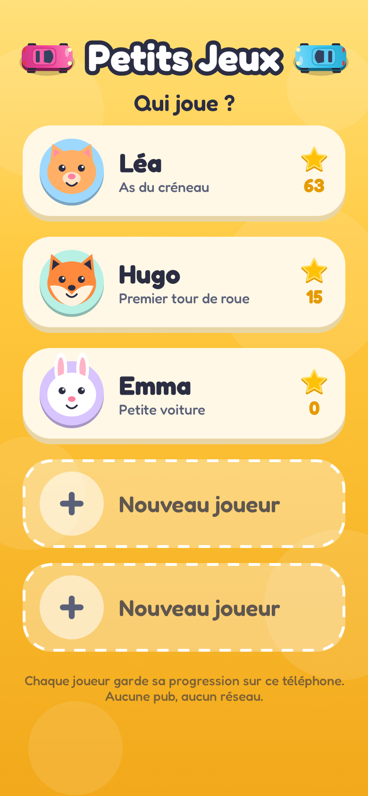 | 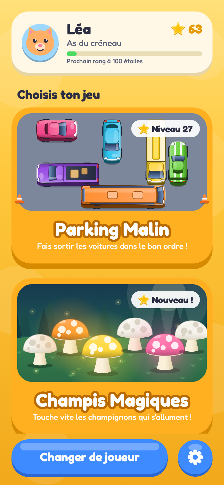 | 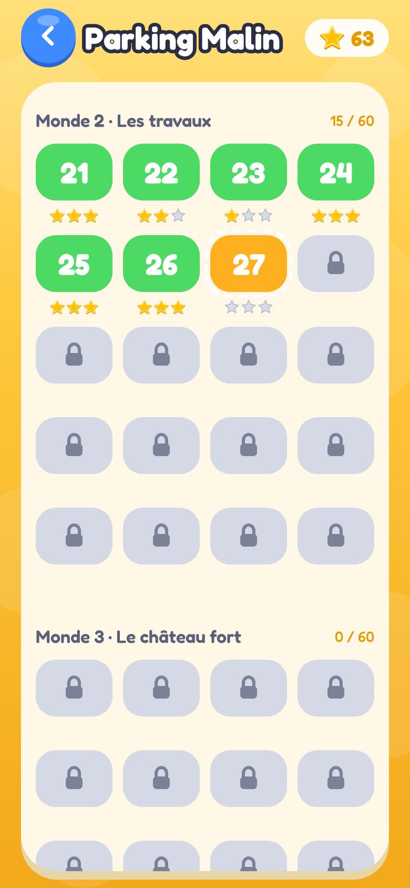 | 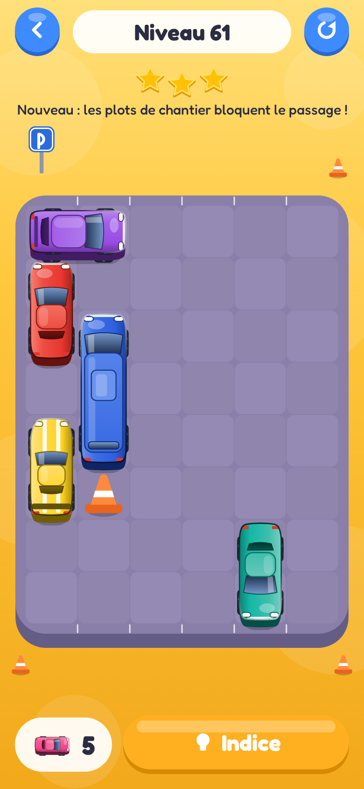 |

| Un véhicule sort | Une faute : « Pouet ! » | Victoire | Nouveau joueur |
|---|---|---|---|
| 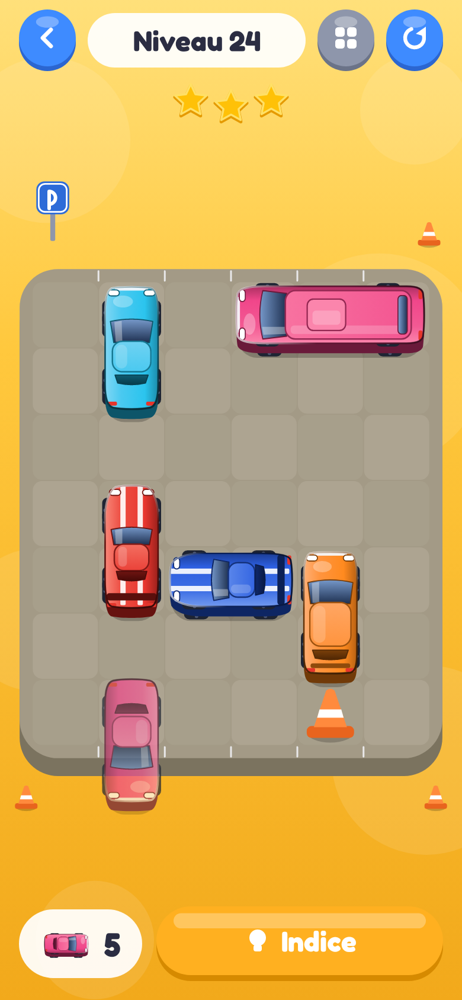 | 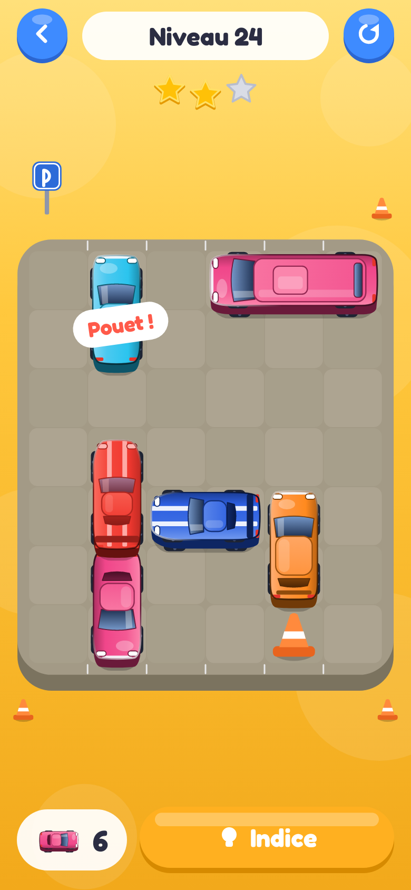 | 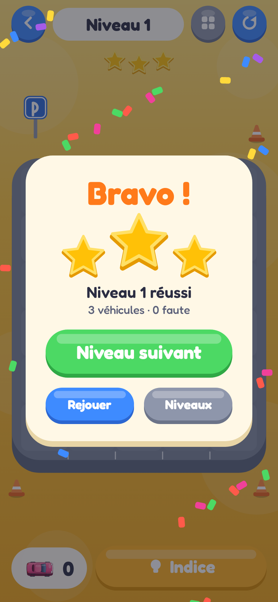 | 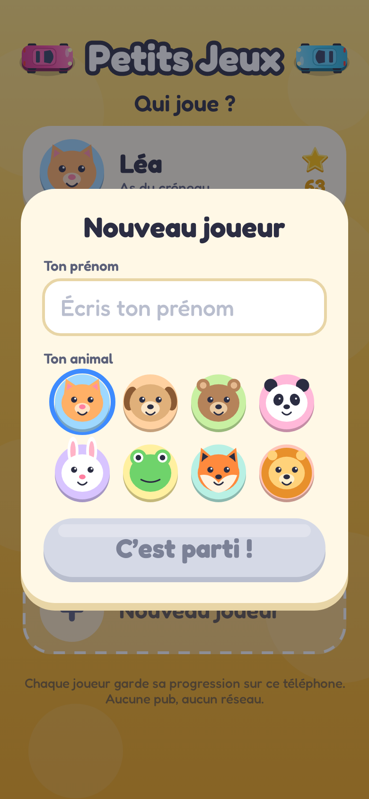 |

| Plots de chantier (61+) | Murs sur le bord (121+) | Caisse tombée (181+) | Collision avec un véhicule qui roule |
|---|---|---|---|
| 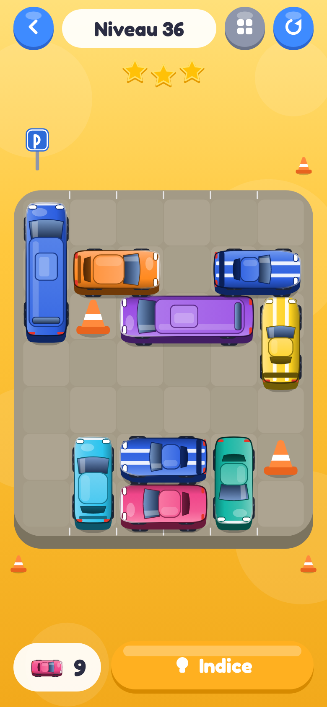 | 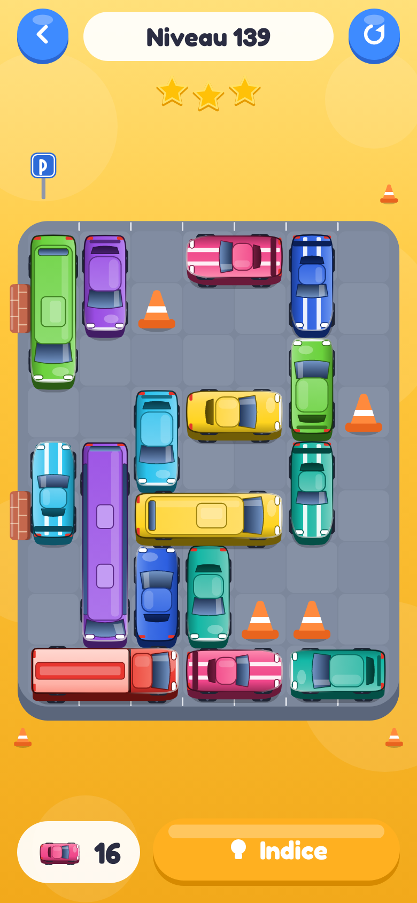 | 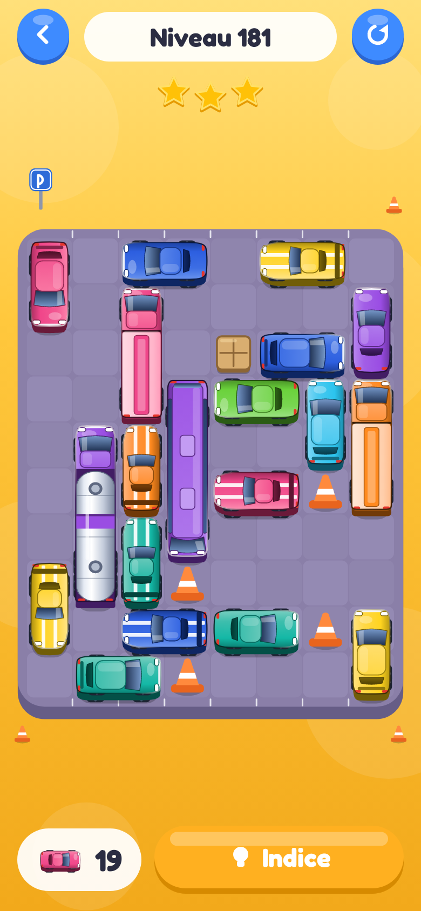 | 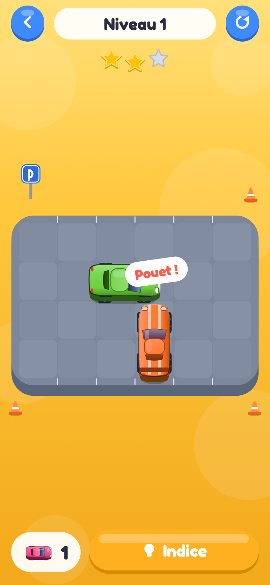 |

## Installer

Android 8 ou plus. L'appli se distribue en **APK signé** (sans Google Play) :

| Quoi | Où |
|---|---|
| Première installation, dernière version (adresse fixe) | <https://github.com/kcharignon/mobile-game/releases/download/android-latest/petitsjeux.apk> |
| Toutes les versions | <https://github.com/kcharignon/mobile-game/releases> |

Sur le téléphone : ouvrir le fichier téléchargé, autoriser l'installation depuis le navigateur si Android le demande, **Installer**
(si Play Protect hésite : *Installer quand même*). **Mettre à jour** : même geste avec la version suivante, par-dessus : les joueurs et leurs étoiles sont conservés.

## Champis Magiques

- Une forêt de **champignons blancs de tailles différentes** : certains **s'allument**, il faut les **toucher le plus vite possible** — plus on est rapide, plus on marque de points.
- **On ne perd jamais** : une partie dure un nombre fixe de champignons et finit toujours avec au moins une étoile.
- **4 difficultés** à choisir : « Petit champi » (ils restent allumés), « Champi rapide » (plus nombreux), « Champi filant » (ils s'éteignent si on est trop lent) et « Champi malin » (avec une **couleur interdite**, le violet). On débloque la suivante avec **2 étoiles** sur la précédente.

## Parking Malin

- **Glisse un véhicule le long de sa longueur : il roule tout droit, en marche avant ou en marche arrière selon le sens où tu le glisses** (un simple toucher le fait avancer).
  Voie libre dans ce sens : il sort. Sinon il klaxonne (« Pouet ! »), rougit et revient : c'est une **faute**.
- Des **voitures** (3 modèles), des **camions** (pick-up, camion de livraison, fourgon) et, plus loin, des **bus** et des **camions-citernes** : 8 véhicules dessinés par le code ([aperçu](docs/design/vehicules.png)).
- On gagne quand **toutes** les voitures sont sorties. Pas de chronomètre, jamais de « perdu ».
- **Étoiles** : 0 faute = 3 ★, 1 ou 2 fautes = 2 ★, plus = 1 ★. Un bouton **Indice** gratuit entoure une voiture qui peut sortir.
- **180 niveaux**, générés de façon déterministe et **toujours solubles**. **Tous les 20 niveaux, le parking s'agrandit ET une nouvelle mécanique arrive** (elles se cumulent) : marche avant et arrière (1-20), **plots de chantier** (21-40), **murs sur le bord** qui ferment des sorties (41-60), **pick-up qui laissent tomber une caisse** derrière eux, toujours sur la même case (61-80), **taches d'huile** où l'on tourne à droite en avançant et à gauche en reculant (81-100), **sens uniques** (101-120), **tapis roulants** qui poussent d'une case de côté (121-140), **téléporteurs** (141-160) et **barrières** qui s'ouvrent et se ferment à chaque véhicule qui sort (161-180). Les premiers niveaux de chaque mécanique sont plus simples.
- **Les véhicules qui roulent se percutent s'ils se touchent vraiment à l'écran** (avec un peu de marge : s'ils se frôlent, ça passe). Deux véhicules l'un derrière l'autre sur la même file peuvent partir à la suite.
- **L'évolution du joueur** : ses étoiles font monter son **rang** (Petite voiture, …, Légende du parking), affiché partout où il apparaît.

Règles complètes, sauvegarde et architecture : [`docs/DESIGN.md`](docs/DESIGN.md) ; maquettes : [`docs/design/`](docs/design/).

## Les sauvegardes

5 emplacements, un fichier JSON par joueur dans le stockage **privé** de l'appli (`files/saves/slot-<n>.json`) : écriture **atomique**
(une coupure en pleine écriture ne corrompt rien), fichier illisible mis de côté sans plantage, version du format pour migrer sans rien perdre.
Chaque jeu garde **sa part** de la sauvegarde. Elles survivent aux mises à jour ; elles disparaissent si l'on désinstalle l'appli.

## Développement : tout tourne dans Docker

Aucun JDK ni SDK Android à installer : seulement Docker.

```bash
make android               # APK de débogage : dist/petitsjeux-debug.apk (le premier lancement télécharge le SDK et Gradle : plusieurs minutes)
make android-test          # tests Kotlin : règles, solveur, solubilité des 180 niveaux, sauvegardes, mise à jour
make android-screenshots   # rend les écrans en PNG (Robolectric, sans téléphone) dans docs/screenshots/ et joue de vrais parcours
make android-release-selftest  # prouve la chaîne de publication signée avec une clé jetable
make design                # régénère les maquettes SVG (PNG : node tools/design/render.js, demande Playwright)
make help                  # toutes les commandes
```

Chaîne : JDK 17 en conteneur, Gradle 8.14, plugin Android 8.13, Kotlin 2.2, Jetpack Compose (BOM 2025.03). **Dependabot ne propose aucune montée
majeure** (`.github/dependabot.yml`) : monter la chaîne est un chantier à faire d'un bloc, à la main. Sans Docker : ouvrir `android/` dans Android Studio (JDK 17).

## Organisation du dépôt

```
android/app/src/main/java/com/kcharignon/petitsjeux/
  core/save      joueurs, sauvegarde JSON atomique (5 emplacements), rangs
  core/ui        thème, boutons, étoiles, avatars : le kit commun à tous les jeux
  core/screens   « Qui joue ? », accueil des jeux, réglages
  core/          MiniGame (contrat d'un jeu), registre des jeux, navigation, sons et vibrations
  games/parking  Parking Malin : engine/ (règles pures), ui/ (plateau, voitures, animations), progression
  games/mushrooms  Champis Magiques : engine/ (difficultés, score, partie, forêt), ui/ (forêt, champignons, écrans), progression
android/app/src/test/    tests Kotlin ; screenshots/ = interface rendue par Robolectric (sans téléphone)
docs/                    DESIGN.md, maquettes (design/), captures du README (screenshots/)
tools/design/            générateurs (Node, sans dépendance) : maquettes, icône, et les véhicules (vehicles.js -> VehicleArt.kt généré + aperçu)
.github/                 workflows : tests et APK de débogage, publication signée
```

**Ajouter un jeu** : implémenter `MiniGame` (`core/MiniGame.kt`) dans `games/<nom>/` et l'ajouter à `Games.all`. Le menu, la sauvegarde par joueur et le rang suivent tout seuls.

## Publier une version

Procédure complète (clé de signature, secrets GitHub, étiquette) : [`android/PUBLICATION.md`](android/PUBLICATION.md). En bref, une fois la clé et ses secrets en place :

```bash
git tag android-v0.2.0 && git push origin android-v0.2.0
```

Le workflow [`android-release.yml`](.github/workflows/android-release.yml) construit, teste, signe, **contrôle** (certificat attendu, version, permissions, APK non débogable),
publie la release et met à jour `android-latest`. Les pré-versions `android-dev-…` (APK de débogage) sont signées d'une clé publique : ne pas les installer à la place d'une vraie version.

## Mentions

Projet personnel. Les véhicules, avatars, décors et sons sont des créations originales faites par le code (aucune image ni fichier son dans l'appli). Police : [Fredoka](third_party/fredoka/OFL.txt) (licence SIL OFL).
