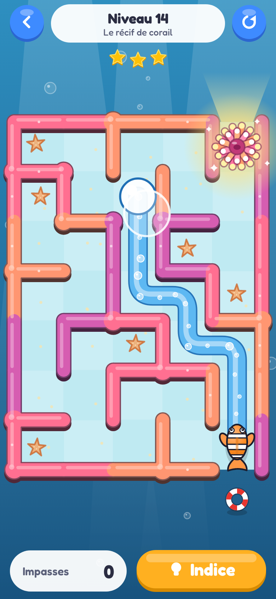
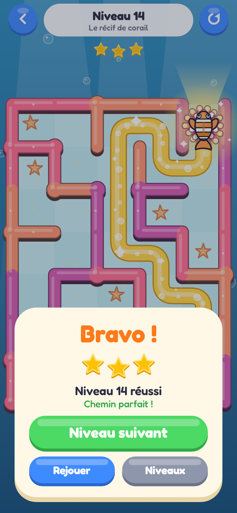
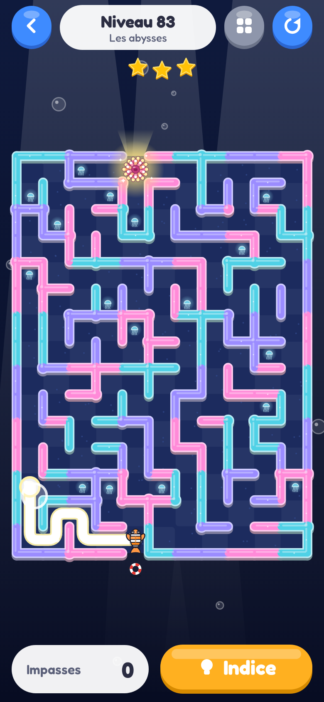
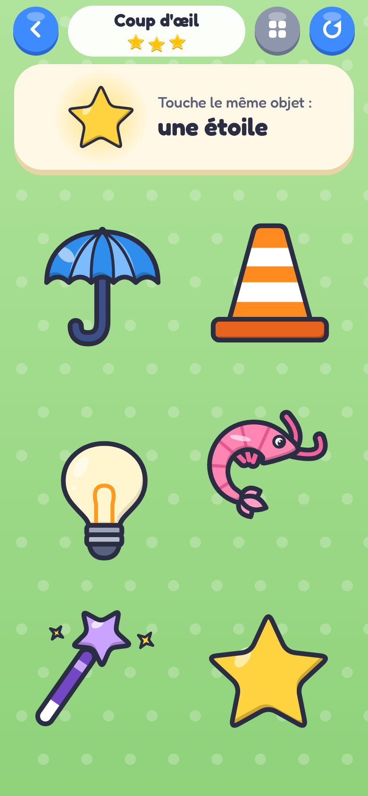
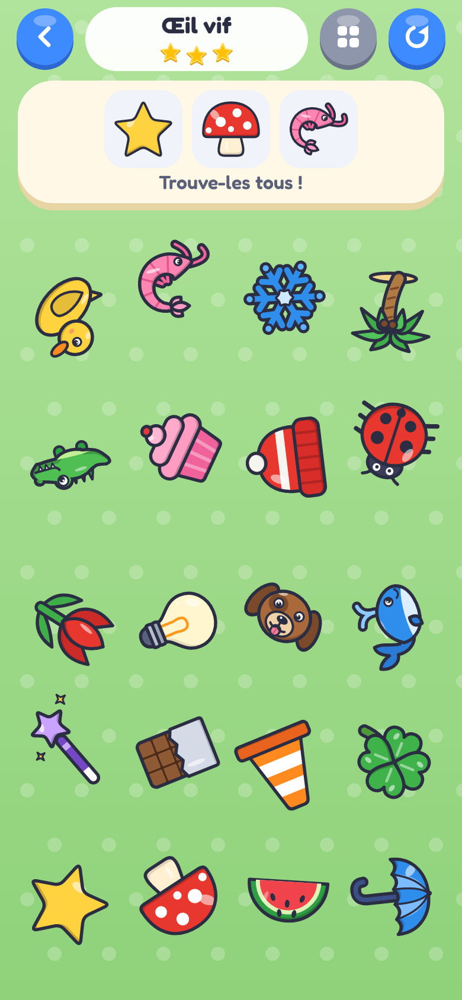
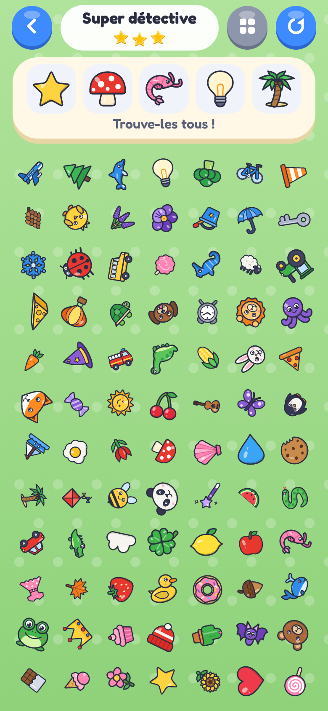

# Petits Jeux

**Des petits jeux pour les enfants, sur Android. Sans pub, sans compte, sans suivi.**

Petits Jeux réunit plusieurs jeux simples dans une seule appli. Au lancement, chacun choisit **qui joue** (jusqu'à 5 joueurs sur le même téléphone,
chacun avec son prénom, son animal, ses étoiles et sa progression), puis **le jeu**. Les gros boutons et le peu de texte sont faits pour les petites mains,
et on ne « perd » jamais : une faute coûte une étoile, jamais la partie. En fin de niveau, le gros bouton vert fait toujours ce qu'on attend : **niveau suivant** dans les jeux à niveaux (ou **rejouer** au dernier), **rejouer** dans les jeux à manches aléatoires, où un bouton orange **monte d'une difficulté** quand elle est ouverte.

| Qui joue ? | Les jeux du joueur | Parking Malin | Champis Magiques |
|---|---|---|---|
|  |  |  |  |

| Poussin Traverse : la petite rue | Poussin Traverse : une grande route, de nuit |
|---|---|
|  |  |

| Poisson Perdu : tracer le chemin | Poisson Perdu : le poisson rentre chez lui | Poisson Perdu : les abysses |
|---|---|---|
|  |  |  |

| Cherche et Trouve : 6 objets, 1 à trouver | Cherche et Trouve : 20 objets, 3 à trouver | Cherche et Trouve : 84 objets, 5 à trouver |
|---|---|---|
|  |  |  |

## Les jeux

### Parking Malin

Des voitures, des camions et des bus sont garés serrés. On les **glisse du doigt** pour les faire sortir un par un, dans le bon ordre : si la voie n'est pas libre,
le véhicule klaxonne (« Pouet ! ») et revient. 180 niveaux, tous faisables, où le parking s'agrandit et où une nouvelle idée arrive tous les 20 niveaux :
marche arrière, plots de chantier, murs, caisses qui tombent des camions, taches d'huile, sens uniques, tapis roulants, téléporteurs, barrières de péage.
Pas de chronomètre, et un bouton **Indice** gratuit.

### Champis Magiques

Dans une forêt, des champignons s'allument : il faut les **toucher le plus vite possible**. Plus on est rapide, plus on marque de points, et on finit toujours
la partie avec au moins une étoile. Quatre difficultés à débloquer, jusqu'à quatre champignons allumés en même temps et même une couleur interdite.
Chaque champignon touché joue la note suivante d'une petite mélodie.

### Poussin Traverse

En paysage. Un poussin doit **traverser la route** : un toucher le fait sauter vers l'avant, un geste du doigt le fait sauter de côté ou en arrière.
Il faut regarder passer les voitures, les scooters, les tracteurs, les bus, les ambulances et même les trains, et choisir son moment.
Des routes de plus en plus larges sur 48 niveaux. Écrasé, le poussin perd quelques points et repart du dernier refuge.

### Poisson Perdu

Un petit poisson-clown est perdu dans un récif de corail. Il faut **poser le doigt sur lui et tracer le chemin** jusqu'à sa maison, une anémone qui brille : la trace suit les couloirs et ne traverse jamais un mur,
et si l'on se trompe on repasse le doigt sur son chemin pour reculer. À l'arrivée, le poisson suit le chemin tracé. 100 niveaux fabriqués à l'avance, dix décors (lagon, épave, banquise, volcan, abysses…),
de 4×5 à 11×16 cases, des boucles et même une maison au milieu du labyrinthe. Pas de chronomètre : les impasses ne coûtent que des étoiles, et un indice est toujours gratuit. Chaque case de la trace joue un petit « bloup » de plus en plus aigu quand on se rapproche de la sortie.

### Cherche et Trouve

Des **objets à trouver** s'affichent en haut : il faut les **retrouver parmi ceux éparpillés** sur l'écran. Comme Champis Magiques, **cinq difficultés** et des manches **tirées au hasard** à chaque partie ; les règles s'additionnent :
6 objets (1 à trouver), puis 12 qui tournent (2), 20 (3), 40 de toutes tailles (4) et 84 (5), toujours rangés dans une grille sans trou. 120 objets différents de toutes les couleurs, dix décors.
Pas de chronomètre et pas de game over : un mauvais objet pâlit et coûte une étoile, c'est tout. Si l'enfant hésite longtemps, un objet à trouver se balance doucement. Pour **débloquer la difficulté suivante**, il faut une manche parfaite : aucune erreur, et tout trouvé avant que les objets se mettent à bouger.

### Et ensuite

Les étoiles gagnées dans tous les jeux font monter le **rang** du joueur, de « Petite voiture » à « Super champion ». D'autres jeux viendront.

## Installer

Android 8 ou plus. L'appli se distribue en **APK signé**, sans passer par Google Play.

1. Sur le téléphone, télécharger la **[dernière version](https://github.com/kcharignon/mobile-game/releases/download/android-latest/petitsjeux.apk)**.
2. Ouvrir le fichier téléchargé. Si Android le demande, autoriser l'installation depuis le navigateur, puis toucher **Installer**
   (si Play Protect hésite : *Installer quand même*).

**Les mises à jour se font dans l'appli** : quand une nouvelle version existe, un gros bouton vert « Mettre à jour » apparaît dès le premier écran. Les joueurs et leurs étoiles sont conservés.
Toutes les versions sont sur la page des [releases](https://github.com/kcharignon/mobile-game/releases).

## Vie privée

Petits Jeux est fait pour des enfants : **il ne collecte rien**.

- **Aucune donnée collectée.** Pas de compte, pas de publicité, pas de statistiques d'usage, aucun outil de suivi ni service tiers dans l'appli.
- **Tout reste sur le téléphone.** Les prénoms, les animaux, les étoiles et la progression sont dans des fichiers privés de l'appli. Ils ne sont envoyés nulle part et
  disparaissent si l'on désinstalle l'appli. Si la sauvegarde automatique d'Android est activée sur le téléphone, c'est elle (et non l'appli) qui peut en garder une copie
  dans le compte Google de son propriétaire.
- **Internet sert uniquement à la mise à jour.** Au lancement, l'appli demande à `github.com` s'il existe une nouvelle version (un petit fichier public), sans envoyer
  d'identifiant ni d'information sur le joueur. Comme pour tout téléchargement, GitHub voit l'adresse IP de la connexion.
- **Permissions demandées** : la vibration (désactivable dans les réglages), Internet et l'installation d'applications, uniquement pour le bouton « Mettre à jour ».

Le code est public : tout cela peut se vérifier.

## Pour aller plus loin

Règles détaillées des jeux, sauvegarde et architecture : [`docs/DESIGN.md`](docs/DESIGN.md). Compiler, tester et publier : [`docs/DEVELOPPEMENT.md`](docs/DEVELOPPEMENT.md).

## Mentions

Projet personnel. Les véhicules, avatars, décors, la mélodie et presque tous les sons sont des créations originales faites par le code ; seuls les quatre klaxons
viennent de [Mixkit](third_party/mixkit/README.md) (licence Mixkit Sound Effects). Police : [Fredoka](third_party/fredoka/OFL.txt) (licence SIL OFL).
