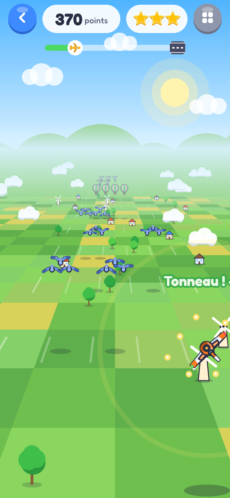
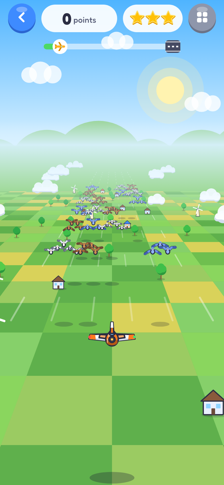
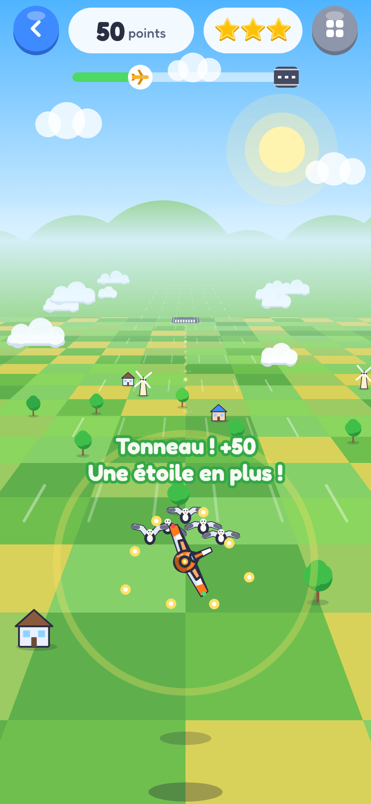
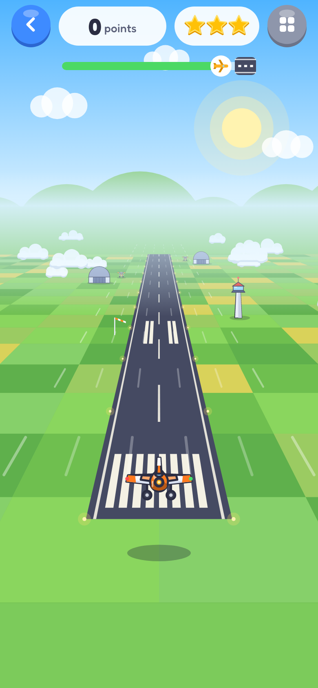
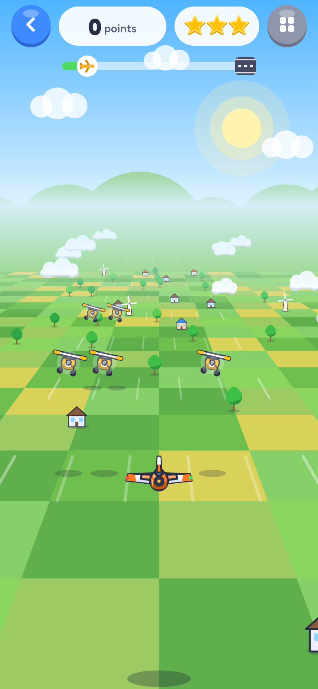
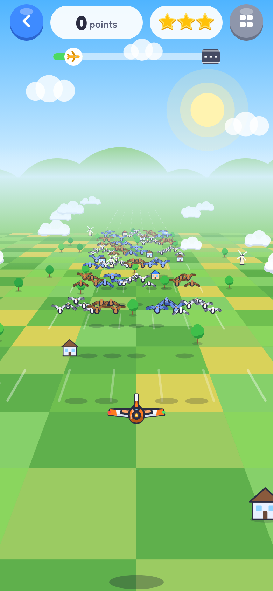

# Petits Jeux — document de design

Appli Android **sans pub et sans suivi**, pour les enfants : un menu principal où l'on choisit **qui joue** (5 sauvegardes
locales distinctes), puis **le jeu**. Six jeux : **Parking Malin** (des voitures garées, à faire sortir une par une dans le bon ordre), **Champis Magiques** (des champignons s'allument, à toucher vite), **Poussin Traverse** (traverser des routes de plus en plus larges, en paysage), **Poisson Perdu** (tracer au doigt le chemin d'un labyrinthe de corail jusqu'à la sortie), **Cherche et Trouve** (retrouver des objets parmi d'autres) et **Super Avion** (glisser le doigt de gauche à droite pour piloter un avion qui évite oiseaux, avions, montgolfières et parapentes, traverse des anneaux lumineux et atterrit à l'aéroport).
D'autres jeux viendront : le menu et la sauvegarde sont faits pour ça.

Maquettes : [`docs/design/`](design/) (SVG générés par `tools/design/`, PNG rendus à côté). Elles sont la référence visuelle ;
le Kotlin reprend les mêmes proportions.

| Écran | Maquette |
|---|---|
| Planche de style (voitures, couleurs, composants) | [`00-planche-style.png`](design/00-planche-style.png) |
| Choix du joueur (5 emplacements) | [`01-choix-joueur.png`](design/01-choix-joueur.png) |
| Nouveau joueur (prénom + animal) | [`02-nouveau-joueur.png`](design/02-nouveau-joueur.png) |
| Accueil : les jeux du joueur | [`03-accueil-jeux.png`](design/03-accueil-jeux.png) |
| Choix du niveau | [`04-niveaux.png`](design/04-niveaux.png) |
| Jeu, faute (« Pouet ! »), indice | [`05-jeu.png`](design/05-jeu.png), [`06-jeu-pouet.png`](design/06-jeu-pouet.png), [`08-jeu-indice.png`](design/08-jeu-indice.png) |
| Victoire | [`07-victoire.png`](design/07-victoire.png) |

## Principes

- **Pensé pour un enfant** : gros boutons, peu de texte, jamais de « perdu » : une faute coûte une étoile, pas la partie. Un bouton **Indice** gratuit.
- **Fin de niveau : le gros bouton vert fait toujours ce qu'on attend.** Jeux à **niveaux prédéfinis** (Parking Malin, Poussin Traverse, Poisson Perdu) : **« Niveau suivant »**, sauf au tout dernier niveau, où il n'y a rien au-dessus : le vert devient **« Rejouer »** (et la rangée du bas ne garde que « Niveaux »). Jeux à **manches aléatoires** (Champis Magiques, Cherche et Trouve, Super Avion) : le vert est **toujours « Rejouer »** (même difficulté, nouvelle manche) ; l'orange **« Difficulté suivante »** apparaît dès que la difficulté d'après est ouverte (y compris à l'instant où la manche vient de l'ouvrir) ; le gris ramène au choix de la difficulté.
- **Zéro pub, zéro suivi.** Permissions : la vibration (retour tactile, désactivable), et Internet + installation **uniquement pour la mise à jour** de l'appli (voir plus bas).
- **Portrait** partout, une main, Android 8+ (API 26) ; **sauf Poussin Traverse, qui force le paysage** (voir plus bas).
- **Rapide** : tout est dessiné par le code (Canvas), pas d'image, pas de son à charger. Les sons sont synthétisés.
- **Extensible** : un jeu = un module qui reçoit le joueur courant et sait lire/écrire **sa part** de la sauvegarde.

## Parcours

```
Lancement ─► Choix du joueur ─► Accueil (jeux) ─► Choix du niveau ─► Jeu ─► Victoire ─► niveau suivant
                 │  ▲                  │
                 │  └──── « Changer de joueur »
                 └─► Nouveau joueur (prénom + animal)      engrenage : son, vibration, effacer ce joueur
```

- Au lancement on arrive **toujours** sur le choix du joueur (appareil partagé entre frères et sœurs).
- Un emplacement vide propose « Nouveau joueur » ; un emplacement plein se touche pour jouer. Modifier / effacer : engrenage de l'accueil
  (effacer demande une confirmation à deux temps).
- Le bouton retour du téléphone remonte d'un écran ; sur le choix du joueur il quitte l'appli.

## Mise à jour de l'appli (sans rien connaître à un « APK »)

- Au lancement, l'appli regarde discrètement s'il existe une version plus récente : une seule petite requête HTTPS vers `github.com` (le fichier `version.json` de la release
  `android-latest`), sans identifiant ni envoi de données. Pas de réseau ? Elle ne dit rien, **mais elle recommence chaque fois qu'on revient dans l'appli** (si la dernière recherche a échoué, ou date de plus de 10 minutes) : un téléphone sans réseau au lancement n'empêche plus d'être prévenu.
- S'il y en a une, un **gros bouton vert « Nouvelle version ! Mettre à jour »** apparaît **dès le premier écran (« Qui joue ? »)**, et aussi sur l'accueil du joueur. Le numéro de la version installée est écrit en bas du premier écran. Un seul geste : l'appli télécharge, **vérifie l'empreinte SHA-256**
  du fichier (celle de `version.json`), puis ouvre la fenêtre « Installer » d'Android.
- **La première fois seulement**, Android demande d'autoriser Petits Jeux à installer des mises à jour : un bouton orange « Autoriser » explique quoi faire, et l'installation
  continue toute seule au retour dans l'appli.
- Réglages > « Chercher une mise à jour » fait la même chose à la demande, et affiche le numéro de la version installée.
- **Sécurité** : seules les adresses `https://github.com/kcharignon/mobile-game/releases/download/…` sont acceptées, et Android **refuse** toute mise à jour qui ne serait pas
  signée de la même clé : personne d'autre ne peut pousser une mise à jour. Les joueurs et leurs étoiles sont conservés.
- Code : `core/update/` (machine d'états testée sans téléphone, réseau testé contre un petit serveur local), interface dans `core/screens/UpdateUi.kt`.

## Parking Malin : règles

- Un parking = une grille (de 5×6 à 11×13 cases) ; des **voitures** (2 cases : berline, citadine, sportive), des **camions** (3 cases : pick-up, camion de livraison, fourgon)
  et, à partir du monde 3 (niveau 41), des **bus et poids lourds** (4 cases : autobus, camion-citerne), larges d'une case, garés dans les 4 directions.
  Le **nez** (phares blancs, grand pare-brise ; l'arrière a une petite lunette teintée) montre le sens de la **marche avant**.
- **Chaque véhicule peut rouler en marche avant ou en marche arrière, selon le sens où on le glisse.**
  - **Glisser** un véhicule le long de sa longueur, dans un sens ou dans l'autre : il roule tout droit dans ce sens.
  - Un simple **toucher** le fait avancer (marche avant) ; un glissement en travers ne fait rien.
  - Si la voie est libre jusqu'au bord du plateau **dans ce sens**, il **sort** et disparaît : bravo.
  - Sinon il avance jusqu'à toucher l'obstacle, **klaxonne** (« Pouet ! » : un vrai klaxon, de voiture, de camion ou de bus selon le véhicule), devient rouge un instant et revient : c'est une **faute**.
- On gagne quand **tous** les véhicules sont sortis. Pas de chronomètre, pas de limite de coups.
- **Étoiles** d'un niveau : 0 faute = 3 ★ ; 1 ou 2 fautes = 2 ★ ; 3 fautes ou plus = 1 ★. L'indice ne coûte rien.
  Un niveau déjà réussi garde sa meilleure note.
- **Indice** : entoure un véhicule qui peut sortir et fait filer deux **chevrons** dans le sens où il faut le glisser. Il ne conseille jamais un coup qui mène à une impasse.
- **Recommencer** : remet le niveau à zéro (fautes comprises).

### Collisions : seulement si les véhicules se touchent vraiment à l'écran

Deux véhicules ne se percutent **que s'ils se toucheraient visuellement**, avec une marge (**0,25 case** de chaque côté) : s'ils se frôlent, ça passe.

- Un véhicule **à l'arrêt** occupe ses cases : si on envoie un autre véhicule dessus, c'est une faute (« Pouet ! », rebond).
- Un véhicule qui **sort** n'occupe que les cases où il est (ou sera) **au moment où l'autre y passe**. Tous les véhicules qui sortent ont la **même accélération** (la distance parcourue ne dépend que du temps écoulé :
  14 × t² cases) : le moteur sait donc, case par case, à quel instant chacun l'occupe, et ne signale une collision que si les deux instants se chevauchent.
  Conséquences : deux véhicules **l'un derrière l'autre** sur la même file partent à la suite sans se heurter (le deuxième arrive toujours après) ; un véhicule peut **traverser devant** un autre qui arrive encore de loin ;
  il n'y a **pas de couloir fantôme** devant un véhicule qui s'éloigne, et un véhicule sorti du plateau ne gêne plus rien.
- Un véhicule qui **rebondit** (il a foncé sur un obstacle) occupe tout ce qu'il balaie tant qu'il fonce, puis seulement l'endroit où il est quand il revient.
- Un véhicule qui rebondit encore ne peut pas être touché une deuxième fois (un enfant impatient ne perd pas deux étoiles d'un coup).

Le moteur lit la position **dessinée** du véhicule (c'est l'animation qui fait foi) : ce qu'on voit est ce qui compte.

### Comment les niveaux évoluent

**Tous les 20 niveaux, le parking s'agrandit ET une nouvelle mécanique arrive.** Les mécaniques **se cumulent** : on garde les anciennes. Chaque tranche de 20 niveaux est un **monde** :

| Niveaux | Monde | Parking | Mécanique ajoutée | Ce qui change |
|---|---|---|---|---|
| 1 à 20 | Le petit parking | 5×6 | **Marche avant et arrière** | Le sens du glissement choisit le sens du véhicule. Les premiers niveaux obligent à reculer (le niveau 2 le montre). |
| 21 à 40 | Les travaux | 6×7 | **Plots de chantier** | Un plot occupe une case pour de bon : on ne passe pas dessus. **1 plot au début**, puis de plus en plus. |
| 41 à 60 | Le château fort | 7×8 | **Murs sur le bord du parking** | Un mur de briques ferme **la sortie d'une file** : le véhicule arrive jusqu'au bord, mais ne passe pas ; il doit sortir par l'autre bout ou attendre. **1 mur au début**, puis de plus en plus. Les bus (4 cases) arrivent aussi. |
| 61 à 80 | Le port | 8×9 | **Le pick-up laisse tomber une caisse** | En partant, un pick-up (celui qui a une caisse dans sa benne) laisse tomber sa caisse **derrière lui**, toujours sur la **même case : celle que sa queue occupait**. Si un véhicule roule ensuite sur cette caisse, il la **détruit et continue sa route**, mais c'est **une faute** (jamais de partie perdue). **1 pick-up au début**, jusqu'à 3. |
| 81 à 100 | La station-service | 9×10 | **Taches d'huile** | Un véhicule qui roule sur une tache fait un **virage à 90°** : **à droite s'il avance, à gauche s'il recule**. Puis il repart tout droit dans ce nouveau sens jusqu'au bord : c'est là qu'il sort (et les murs comptent à cet endroit). **1 tache au début**. |
| 101 à 120 | Le parking à étages | 10×11 | **Sens uniques** | Un panneau bleu à flèche blanche : on ne franchit la case que **dans le sens de la flèche**. Dans l'autre sens, ou en travers, le véhicule avance jusqu'au panneau, klaxonne et revient. **1 panneau au début**. |
| 121 à 140 | L'usine | 10×12 | **Tapis roulants** | Un véhicule qui **traverse** un tapis (en travers) est **poussé d'une case de côté**, sans tourner, puis continue tout droit dans sa nouvelle file. Dans le sens du tapis ou à contresens, il n'a aucun effet. **1 tapis au début**. |
| 141 à 160 | Le parc magique | 11×12 | **Téléporteurs** | Deux cases de la même couleur : un véhicule qui entre par l'une **ressort par l'autre**, dans le même sens, puis continue tout droit. Il s'efface d'un côté et réapparaît de l'autre. **1 paire au début**, jusqu'à 3. |
| 161 à 180 | Le péage | 11×13 | **Barrières de péage** | Une barrière est posée **entre deux cases voisines**, comme un petit mur, et son bras rayé rouge et blanc **se lève ou se baisse comme celui d'un passage à niveau** : baissée, on ne passe pas d'une case à l'autre (le véhicule s'arrête devant et klaxonne) ; levée, on passe. **Toutes les barrières changent à chaque véhicule qui sort du parking** (qu'il passe par elles ou non), avec une animation d'une demi-seconde ; le feu du poteau est rouge quand c'est fermé, vert quand c'est ouvert, et clignote tant que le bras bouge. Le **bon ordre** compte : l'indice ne conseille jamais un coup qui baisserait une barrière pour toujours. Une barrière ne prend **aucune case** (des véhicules peuvent être garés des deux côtés). **On n'est jamais bloqué pour de bon** : un véhicule qui klaxonne devant une barrière baissée la fait changer aussi (c'est une faute), et l'indice le montre. **1 barrière au début**, jusqu'à 4. |

- **Les premiers niveaux d'un monde sont plus simples** : à chaque début de monde (niveaux 1, 21, 41, 61, 81, 101, 121, 141, 161), les 3 premiers niveaux ont 55 % des véhicules habituels, les 3 suivants 75 %, les 3 suivants 90 %,
  avec un seul élément de la nouveauté au départ. La difficulté remonte ensuite. Le premier niveau de chaque mécanique (et les niveaux 1 à 3) affiche un petit mot qui explique la nouveauté ;
  ce même niveau est aussi celui où le parking s'agrandit.
- Dans les niveaux avec une mécanique, celle-ci **sert vraiment** : le générateur choisit des plans où chaque plot, mur, huile, sens unique, tapis, téléporteur ou barrière touche le trajet d'au moins un véhicule.
- **Les 100 premiers niveaux ne changent plus** : leurs étoiles sont rangées par numéro de niveau (un test d'empreinte le vérifie). Pour ajouter une mécanique : ajouter un monde dans `Worlds`, sa taille dans `LevelGenerator.sizes` et ses réglages dans `LevelGenerator.paramsFor`.
- Les grands parkings (jusqu'à 11×13) rendent les cases plus petites : environ 5 mm de large sur un téléphone ordinaire.

**La caisse** : le pick-up peut partir dans les deux sens, mais la caisse ne tombe pas au même endroit : s'il part vers l'avant, elle tombe sur la case de sa queue ;
s'il recule, elle tombe sur la case de son nez (le bout qui reste « derrière » dans ce sens). Choisir le bon sens, et le bon moment, est le casse-tête. **Une caisse ne bloque jamais** : un véhicule qui passe dessus la casse (elle éclate en morceaux quand il arrive sur sa case) et sort quand même, mais chaque caisse cassée est **une faute** (comme un coup de klaxon), donc des étoiles en moins. Une caisse mal placée ne fait plus perdre la partie. L'indice ne conseille jamais un coup qui laisserait une caisse à un mauvais endroit tant qu'il en existe un autre ; si c'est déjà arrivé, il montre le coup qui en casse le moins.

**Le sol, en détail** : tout ce qui est au sol (huile, sens unique, tapis, téléporteur) est sur une case où **aucun véhicule n'est garé** ; les barrières de péage, elles, sont **entre deux cases** (jamais au milieu d'un véhicule garé). Le trajet d'un véhicule est calculé case par case, dans l'ordre :

- **huile** : virage dans le sens de la marche (à droite en avançant, à gauche en reculant). À l'écran, les deux bouts d'une même file tournent du **même côté** ;
- **tapis** : poussée d'une case de côté en travers ; si elle sort du plateau, le véhicule glisse hors du plateau par le côté (un mur sur ce bord le bloque) ;
- **téléporteur** : saut vers l'autre case de la paire, sans effet à l'arrivée (jamais d'aller-retour), puis tout droit ;
- **sens unique** : franchissable seulement dans le sens de sa flèche, sinon le trajet s'arrête devant ;
- un trajet qui **tourne en rond**, ou qui **reviendrait sur la place du véhicule**, n'est pas un trajet : il ne peut pas sortir par là ;
- **barrière de péage** : franchissable seulement quand elle est levée ; on la rencontre en passant d'une case à la suivante (le trajet s'arrête juste devant), y compris quand un tapis pousse le véhicule de côté ; un saut de téléporteur n'en traverse aucune ;
- le chemin doit être libre (véhicules, plots, barrières baissées) et la sortie finale ne doit pas être murée. L'**indice** et le **solveur** suivent exactement ces trajets.

### Niveaux

**180 niveaux** en 9 mondes de 20, **générés de façon déterministe** (le niveau *n* est toujours le même) et **toujours solubles**.

| Monde | Niveaux | Parking | Véhicules | Plots | Murs | Pick-up | Taches | Sens uniques | Tapis | Téléporteurs | Barrières |
|---|---|---|---|---|---|---|---|---|---|---|---|
| Le petit parking | 1-20 | 5×6 | 3 → 6 | 0 | 0 | 0 | 0 | 0 | 0 | 0 | 0 |
| Les travaux | 21-40 | 6×7 | 4 → 10 | 1 → 2 | 0 | 0 | 0 | 0 | 0 | 0 | 0 |
| Le château fort | 41-60 | 7×8 | 6 → 14 | 2 → 3 | 1 → 3 | 0 | 0 | 0 | 0 | 0 | 0 |
| Le port | 61-80 | 8×9 | 9 → 20 | 3 → 4 | 3 → 4 | 1 → 2 | 0 | 0 | 0 | 0 | 0 |
| La station-service | 81-100 | 9×10 | 12 → 25 | 4 → 5 | 4 → 6 | 2 → 3 | 1 → 5 | 0 | 0 | 0 | 0 |
| Le parking à étages | 101-120 | 10×11 | 15 → 31 | 5 → 6 | 6 → 7 | 3 | 5 → 6 | 1 → 2 | 0 | 0 | 0 |
| L'usine | 121-140 | 10×12 | 16 → 33 | 6 → 7 | 7 → 8 | 3 → 4 | 6 → 7 | 2 → 3 | 1 → 2 | 0 | 0 |
| Le parc magique | 141-160 | 11×12 | 17 → 34 | 7 → 8 | 8 → 9 | 4 | 7 → 8 | 4 → 5 | 2 → 4 | 1 → 2 | 0 |
| Le péage | 161-180 | 11×13 | 18 → 34 | 8 → 9 | 9 → 10 | 4 → 5 | 8 → 9 | 5 → 6 | 4 → 5 | 2 → 3 | 1 → 4 |

**Pourquoi c'est toujours soluble** : faire sortir un véhicule libère toujours de la place. Sans caisse ni barrière, le niveau est donc soluble si et seulement si on peut tout vider en retirant à chaque fois un véhicule qui a **une voie libre dans un sens ou dans l'autre**
(en suivant les virages, les poussées et les sauts du sol, sans véhicule ni plot ni caisse, et **sans mur à la sortie**). Les pick-up qui laissent tomber une caisse **ajoutent** un obstacle pour le **solveur** (qui cherche le parcours sans aucune faute) : seuls eux demandent de chercher le bon ordre, et ils sont peu nombreux,
donc la recherche du solveur (`Solver`) est minuscule. Dans le jeu, une caisse n'est qu'un obstacle « mou » : la casser est une faute, jamais une impasse. Les **barrières** changent à chaque sortie, donc l'ordre compte : l'état est alors (véhicules restants, caisses, parité du nombre de sorties ; pour chaque trajet, le solveur sait quelles barrières il traverse), et le solveur fait une recherche en profondeur mémorisée,
bornée (en essayant d'abord les véhicules que les barrières concernent). Dans le jeu, si la recherche est trop longue pour conclure, on suppose que c'est faisable (jamais de conseil de klaxonner à tort) ; le générateur, lui, n'accepte que les niveaux dont il est sûr.
Un test vérifie les 180 niveaux en suivant les indices sans faute, et un autre que les niveaux ne changent jamais (empreinte).
La **difficulté** vient du nombre de « vagues » de sorties (la longueur de la plus longue suite de dépendances) et du peu de véhicules libres au départ ; dans les derniers mondes, on cherche aussi des **pièges**
(un coup qui paraît bon mais mène à l'impasse).

**Tous les niveaux sont jouables dès le début** : les niveaux pas encore réussis sont gris (avec leur numéro, sans cadenas), et un enfant qui trouve le jeu trop simple peut sauter en avant. « Niveau suivant » enchaîne depuis le niveau qu'on vient de finir ; en revenant dans le jeu, le menu s'ouvre sur **le niveau le plus loin réussi + 1** (en orange, avec la carte de l'accueil qui dit « Niveau N »). Les niveaux laissés derrière restent à faire, et réussir un niveau plus ancien ne fait pas reculer le point de reprise.

## Champis Magiques : règles

Un jeu d'adresse et de réflexes, **où l'on ne perd jamais** : le but est de s'amuser et d'entraîner sa dextérité.

- **La forêt** : une forêt du soir (bleu-vert profond, sapins, lucioles) remplie de **champignons blancs de tailles différentes**, de 12 à 20 selon la difficulté. Tous les champignons sont assez grands pour un doigt d'enfant (chapeau d'au moins 52 dp).
- **Le jeu** : des champignons **s'allument** (jaune, orange, rose, cyan ou vert, avec un halo qui pulse). L'enfant doit **les toucher**. On réagit **dès que le doigt se pose** (pas besoin de le relever), et à plusieurs doigts si on veut. Toucher un champignon éteint ne fait rien et ne coûte rien.
- **Le score** : plus on touche vite un champignon allumé, plus il rapporte : **100 points tout de suite, environ 60 après 1 seconde, 38 après 2, 19 après 4, jamais moins de 10**. Des points « +85 » montent au-dessus du champignon touché, des étincelles jaillissent.
- **Le son : une petite mélodie.** Pas de musique de fond : **chaque champignon touché joue la note suivante d'une mélodie** de 32 notes (boîte à musique), qui recommence au début de chaque partie et quand elle est finie. Le rythme est celui des doigts de l'enfant ; l'ensemble des touchers chante. La mélodie est en do majeur pentatonique (comme la fanfare et les « ding » des étoiles : rien ne sonne faux, même très vite ou en se chevauchant), faite de 4 phrases autour d'un motif (sol la sol mi), avec un point culminant à la 14e note pour qu'une partie courte l'entende aussi. Le **dernier** champignon d'une partie joue un accord de do plein au lieu de la note suivante (on s'arrête presque toujours au milieu de la mélodie). Un champignon interdit, ou raté, ne fait pas avancer la mélodie. Elle a été composée par un agent « compositeur » puis vérifiée par des tests (gamme, sauts, répétitions, boucle) ; elle n'a pas été écoutée sur un téléphone.
- **Une partie** : un nombre fixe de champignons à toucher (15 à 30 selon la difficulté), puis la partie finit toujours, avec **au moins 1 étoile** (2 et 3 étoiles selon le score). On ne perd jamais : un champignon qui s'éteint tout seul n'est qu'un champignon raté, sans punition, et la partie continue.
- **Au début d'une partie** : une fenêtre explique le jeu (« Appuie vite sur les champignons qui s'allument ! ») et le chronomètre ne démarre que quand l'enfant appuie sur **« C'est parti ! »**. « Rejouer » relance tout de suite.

### Les difficultés

On **choisit sa difficulté** au début ; on **débloque la suivante en faisant 2 étoiles sur la précédente**. La première est toujours ouverte.

| Difficulté | Champignons | À toucher | Allumés en même temps | Ce qui change | 2 étoiles | 3 étoiles |
|---|---|---|---|---|---|---|
| Petit champi | 12 | 15 | **1** | Ils **restent allumés** jusqu'à ce qu'on les touche | 700 | 1000 |
| Champi rapide | 16 | 20 | **2** | Plus de champignons, **deux allumés en même temps** | 800 | 1300 |
| Champi filant | 18 | 25 | **3** | Trois allumés en même temps, et ils **s'éteignent au bout de 4 s** si on est trop lent | 700 | 1300 |
| Champi malin | 20 | 30 | **4** | Quatre allumés en même temps, ils s'éteignent au bout de 3,6 s, et des champignons **violets (interdits)** s'allument aussi : il ne faut pas les toucher | 650 | 1300 |

- **Plusieurs allumés en même temps** : le nombre de champignons allumés **monte de 1 à chaque difficulté (1, 2, 3, puis 4)**. Ils ne s'allument pas tous d'un coup : ils s'allument **l'un après l'autre** (quelques dixièmes de seconde d'écart), et **dès qu'il en manque un** (touché ou éteint), un nouveau s'allume vite, **sans attendre que les autres soient touchés ou éteints**. Un joueur rapide voit donc presque toujours le maximum allumé. Le petit champi reste comme avant : un seul champignon à la fois.
- **Les étoiles suivent le rythme** : un champignon allumé perd des points tant qu'on ne l'a pas touché, donc quand 4 attendent en même temps, chacun rapporte moins. Les seuils d'étoiles sont réglés pour un joueur qui touche un champignon à la fois : environ 0,5 s par champignon pour 3 étoiles (la 1re difficulté est plus tolérante), environ 1 s pour 2 étoiles. Les seuils ont été calibrés par simulation, pas avec de vrais enfants.
- **La couleur interdite** (violet, avec une barre rouge) ne vient qu'à la dernière difficulté, et on la rappelle partout : dans la fenêtre du début et dans une pastille « Pas les violets ! » en haut de l'écran. Un champignon interdit touché ne donne **aucun point** et remet la série à zéro (aucune punition, la partie continue) ; s'il n'est pas touché, il s'éteint tout seul au bout de 2,5 s. Les interdits ne comptent pas parmi les champignons à toucher.
- **Les étoiles comptent pour le rang** du joueur, comme celles de Parking Malin (jusqu'à 12 étoiles : 4 difficultés × 3).
- **Sauvegarde** (`games.mushrooms`) : le meilleur score de chaque difficulté, le nombre de champignons touchés, de parties jouées et la plus longue série. Les étoiles se déduisent du meilleur score.

### Comment c'est fait

Le moteur (`games/mushrooms/engine`) est du Kotlin pur piloté par une horloge simulée : `MushroomRound` allume et éteint les champignons, `Scoring` donne les points, `ForestLayout` place des champignons de tailles variées sans qu'ils se touchent (graine fixe = même forêt), `Difficulty` décrit les quatre difficultés. Des tests jouent des parties complètes avec des « enfants » qui touchent chaque champignon un certain temps après son allumage, et avec un enfant plus vrai qui touche **un champignon à la fois** (0,45 s, 0,9 s ou 2,2 s par champignon) : ils vérifient le score, les étoiles, qu'on ne perd jamais, et que le nombre d'allumés en même temps monte bien à 1, 2, 3 puis 4.
L'interface (`games/mushrooms/ui`) dessine tout au pinceau : `ForestArt` (forêt, champignons, étincelles), le menu des difficultés, l'écran de partie. L'horloge de la partie n'avance que pendant qu'on joue et jamais de plus de 100 ms par image : si l'appli est mise de côté, rien n'expire d'un coup.

## Poussin Traverse : règles

Un jeu d'attention et d'adresse, **où l'on ne perd jamais** : un poussin traverse des routes de plus en plus larges. Se faire écraser fait perdre des points, jamais la partie. L'analyse complète (alternatives écartées, risques) est dans l'[issue #14](https://github.com/kcharignon/mobile-game/issues/14).

- **Toujours en paysage.** Dès qu'on ouvre le jeu (menu des niveaux compris) l'appli se met en paysage, dans les deux sens, même si la rotation automatique est coupée ; en sortant elle retrouve son portrait. Le manifeste déclare `configChanges="orientation|screenSize|…"` : tourner le téléphone ne recrée pas l'activité, donc une traversée en cours n'est pas perdue. (`core/Orientation.kt`, `LockLandscape`.)
- **La scène** : la route est horizontale (14 cases de large), le poussin part du trottoir du bas et saute **vers le haut** ; la caméra le suit. Les véhicules se voient arriver de loin. Les voies du bas vont vers la droite, celles du haut vers la gauche : une **route à double sens**. Des terre-pleins (herbe, buissons) servent de refuges.
- **Les contrôles** (sur tout l'écran, sans bouton) : **toucher** fait sauter le poussin d'une ligne vers l'avant ; **glisser le doigt dans le sens où l'on veut aller** le fait sauter de ce côté (devant, derrière, gauche, droite) dès que le doigt a bougé de 20 dp, un seul saut par glissé. Un doigt qui tremble un peu reste un toucher. Une première version avait une croix de boutons en bas à gauche : sur un vrai téléphone elle ne répondait pas, et la route ne touchait pas le bord de l'écran à gauche ; remplacée par les glissés (0.8.1). La route et les gestes occupent **tout l'écran, bord à bord** (barres système et encoche comprises) ; seuls le bouton retour et les pastilles restent dans les zones sûres. Les glissés qui partent du bord ne déclenchent pas le geste « retour » d'Android (`systemGestureExclusion`). Un geste pendant un saut est gardé et joué à l'atterrissage.
- **Le score** : +10 la première fois qu'on atteint une ligne, +10 par graine ramassée, +50 à l'arrivée, **−15 quand on est écrasé** (le score ne descend jamais sous 0). Pas de chronomètre.
- **Écrasé** : le poussin est aplati en dessin animé (yeux en croix, étoiles, plumes), le véhicule klaxonne, puis il revient **au dernier refuge où il s'est posé** (ou au départ), clignote 1,2 s sans pouvoir être retouché, et la partie continue.
- **Collisions indulgentes** (comme dans Parking Malin) : le poussin se dessine sur 0,32 case de rayon mais n'est touché que sur 0,22, et chaque véhicule est raccourci de 0,08 case à chaque bout : s'ils se frôlent, ça passe. Pendant un saut le poussin compte dans sa ligne de départ pour la première moitié, puis dans la suivante.
- **Les étoiles** : 1 dès l'arrivée (on ne perd jamais), 2 à 50 % du score maximum, 3 à 80 %. Le maximum d'un niveau = toutes les lignes + toutes les graines + l'arrivée. Elles comptent pour le rang, comme celles des autres jeux (jusqu'à 144 : 48 niveaux × 3).
- **Les graines** (dorées, trois grains) donnent une raison de se décaler et de prendre un petit risque. Elles sont posées par le robot (voir plus bas) **le long d'un chemin sans aucune touche** : on peut toujours toutes les ramasser, donc les 3 étoiles sont toujours possibles. Chaque graine ramassée joue la note suivante de la petite mélodie de Champis Magiques.
- **Tous les niveaux sont jouables dès le début** : les niveaux pas encore réussis sont gris (avec leur numéro, sans cadenas), et un enfant qui trouve le jeu trop simple peut sauter en avant. « Niveau suivant » enchaîne depuis le niveau qu'on vient de finir ; en revenant dans le jeu, le menu s'ouvre sur **le niveau le plus loin réussi + 1** (en orange, avec la carte de l'accueil qui dit « Niveau N »). Les niveaux laissés derrière restent à faire, et réussir un niveau plus ancien ne fait pas reculer le point de reprise.

### Les 48 niveaux

8 mondes de 6 niveaux, **déterministes** (le niveau n est le même sur tous les téléphones). Voies : `2 + monde + (indice dans le monde) / 3`, donc de **2 voies** (une dans chaque sens) au niveau 1 jusqu'à **10 voies** au niveau 48. Un terre-plein au milieu dès 4 voies, et **jamais plus de 3 voies d'affilée** sans refuge. Chaque monde apporte de nouveaux véhicules (les anciens restent) ; dans une même voie ils vont tous à la même vitesse (voies lentes, normales, lourdes ou rapides).

| Monde | Niveaux | Nom | Voies | Nouveautés | Ambiance |
|---|---|---|---|---|---|
| 1 | 1-6 | La petite rue | 2-3 | voitures, scooters | jour |
| 2 | 7-12 | Le quartier | 3-4 | camionnettes, tracteurs (très lents) | jour |
| 3 | 13-18 | La nationale | 4-5 | camions, bus (très longs) | campagne |
| 4 | 19-24 | La grande ville | 5-6 | taxis, ambulances (rapides, gyrophare) | ville |
| 5 | 25-30 | L'autoroute | 6-7 | voitures de sport (très rapides) | soir, phares allumés |
| 6 | 31-36 | Le passage à niveau | 7-8 | **voie ferrée** : feux, cloche, puis un train de 14 cases | nuit |
| 7 | 37-42 | L'heure de pointe | 8-9 | tous les véhicules, un train | soir |
| 8 | 43-48 | La mégapole | 9-10 | **deux voies ferrées**, tous les véhicules | nuit |

- **Difficulté** : de niveau 1 à 48, la vitesse de base monte de 1,6 à 2,9 cases/s (× le facteur de la voie : 0,7 lente, 1 normale, 0,85 lourde, 1,45 rapide) et la **fenêtre de passage** entre deux véhicules descend de 3 s à 1,1 s.
- **La voie ferrée** : toutes les 10 s (8 s au monde 8), les feux rouges clignotent et la cloche sonne environ 2,5 s, puis le train traverse toute la route à 12 cases/s (en 2,3 s).

### Garantie « toujours faisable » : le robot

Chaque niveau n'est accepté que si le `Planner` trouve une traversée **sans aucune touche, avec de la marge** (50 essais au plus, sinon le test échoue). C'est une recherche en espace-temps : un état = (ligne, colonne, tick), un tick = 0,1 s, horizon 60 s ; actions : attendre ou sauter (2 ticks). Un état est sûr si aucun véhicule n'est dans une zone **élargie** autour du poussin : la marge de réaction (0,3 case) plus ce que le véhicule parcourt en un tick. Pendant un saut il faut être sûr dans la ligne de départ **et** celle d'arrivée (plus prudent que le vrai moteur). On peut aussi se décaler pour « surfer » sur un trou du trafic. Le robot pose ensuite les graines de graine en graine, dans l'ordre des lignes, en gardant toujours un chemin pour finir. Le test **rejoue le chemin du robot dans le vrai moteur** (horloge injectée) : 0 touche, toutes les graines, l'arrivée, le score maximum, pour les 48 niveaux ; un autre le joue **en touchant l'écran** (Robolectric).

### Dessin et sons

Tout est dessiné par le code (`games/road/ui/RoadArt.kt`). Vue du dessus : bitume avec pointillés entre voies de même sens et double ligne jaune entre sens opposés, trottoirs dallés avec fleurs et passage piéton au départ, damier à l'arrivée, terre-pleins herbeux avec buissons, voie ferrée en gravier avec traverses et feux. 5 ambiances (jour, campagne, ville, soir, nuit : en soirée et la nuit les véhicules allument leurs phares). 9 véhicules (voiture, taxi, voiture de sport, scooter avec son conducteur, camionnette, tracteur, ambulance à gyrophare, camion à remorque, bus) et le train.
Le poussin est jaune, vu du dessus, bec en avant ; il bat des ailes et grossit au sommet du saut, son ombre rétrécit. Sons (synthétisés, pas de musique de fond) : un petit « pip » à chaque saut, la mélodie pour les graines, le vrai klaxon du véhicule qui écrase (voiture, camion ou bus selon sa longueur), une cloche à deux tons quand les feux de la voie ferrée se mettent à clignoter, et les sons habituels de fin de niveau (étoiles, fanfare). **Jamais écoutés sur un téléphone.**

### Comment c'est fait

Le moteur (`games/road/engine`) est du Kotlin pur piloté par une horloge en millisecondes : tout ce qui roule (`Stream`, `TrainLine`) est une **fonction pure du temps** (flux périodique de véhicules : aucune simulation, aucun hasard pendant la partie), `Crossing` est la traversée (sauts, points, écrasements, retour au refuge), `Planner` est le robot, `RoadLevels` génère les 48 niveaux. Le moteur avance par pas de 20 ms au plus pour qu'aucun véhicule ne « traverse » le poussin sans le toucher. La sauvegarde (`games.road`) garde le meilleur score et les étoiles de chaque niveau, le nombre d'écrasements et de traversées.

## Poisson Perdu : règles

Un labyrinthe vu du dessus, **entièrement visible** (ni défilement ni zoom : on peut regarder avant de tracer). Un poisson-clown perdu attend à l'entrée, en bas ; sa maison, une anémone qui brille, est à la sortie, en haut (au milieu du labyrinthe dans quelques niveaux).
**On pose le doigt sur le poisson et on trace le chemin** jusqu'à l'anémone. **Pas de chronomètre, on ne perd jamais** : les erreurs ne font perdre que des étoiles. En portrait, une main. Analyse et plan : [issue #22](https://github.com/kcharignon/mobile-game/issues/22).

### Tracer au doigt

- Le doigt prend la trace s'il se pose **près de sa tête** (à moins de 1,3 case : le poisson au début). Il se pose ailleurs ? Rien ne se passe.
- La trace suit les **couloirs, pas le doigt** : si le doigt est sur une case qu'un couloir relie à la tête, la trace s'allonge le long du couloir, **sans jamais traverser un mur**. Le doigt peut couper un coin (la trace suit le couloir en L) ou frôler un mur sans rien casser. Un doigt de l'autre côté d'un mur ne fait rien : la trace attend devant.
- Un doigt rapide gagne plusieurs cases d'un coup (3 pour un doigt lent, jusqu'à 8), jamais plus.
- **Reculer** : repasser le doigt sur la trace la **rembobine** jusque-là (les bulles de la partie effacée éclatent). La trace est toujours un chemin simple : jamais deux fois la même case. Un doigt qui frôle un couloir voisin du même tracé, loin derrière la tête, n'efface rien.
- **Lever le doigt ne perd rien** : la trace reste, on la reprend en reposant le doigt sur sa tête. La zone de jeu est exclue des gestes système (un glissé au bord ne déclenche pas « retour »).
- **Arriver** : dès que la trace entre dans la case de sortie, c'est gagné, sans geste de validation. Le poisson **suit alors le chemin tracé** jusqu'à son anémone, puis le bilan s'affiche en bas de l'écran (le labyrinthe et la trace restent visibles au-dessus).

### Impasses, étoiles, indice

- **Impasse** : chaque série de pas qui **s'éloigne de la sortie** (par le chemin le plus court) en compte **une**, quelle que soit sa longueur. Dans une grille, deux cases voisines diffèrent toujours d'exactement 1 en distance à la sortie, donc la règle est sans ambiguïté, **avec ou sans boucle** (un plus court chemin existe toujours et ne compte aucune impasse : les 3 étoiles sont toujours possibles). Se ré-engager dans l'impasse après être revenu à l'embranchement en compte une de plus.
- **Étoiles** : 0 impasse = 3 ★, 1 ou 2 = 2 ★, 3 ou plus = 1 ★ (on gagne toujours au moins une étoile). Un niveau déjà réussi garde sa meilleure note. **Tous les niveaux sont jouables dès le début** : les niveaux pas encore réussis sont gris (avec leur numéro, sans cadenas), et un enfant qui trouve le jeu trop simple peut sauter en avant. « Niveau suivant » enchaîne depuis le niveau qu'on vient de finir ; en revenant dans le jeu, le menu s'ouvre sur **le niveau le plus loin réussi + 1** (en orange, avec la carte de l'accueil qui dit « Niveau N »). Les niveaux laissés derrière restent à faire, et réussir un niveau plus ancien ne fait pas reculer le point de reprise.
- **Indice** (gratuit, jamais une étoile en moins) : si la trace est sur le bon chemin, 5 pastilles jaunes de plus en plus petites montrent les prochaines cases ; si elle est dans une impasse, elles montrent le **chemin du retour** jusqu'à l'embranchement. **Recommencer** efface la trace et remet les impasses à zéro.
- **Le son « chaud-froid »** : chaque case gagnée joue un petit « bloup » de bulle, **plus aigu quand la trace se rapproche de la sortie** (8 hauteurs de la gamme pentatonique de do, calculées sur la distance à la sortie), plus grave quand elle s'en éloigne. L'enfant entend s'il est sur la bonne voie sans qu'un mot le lui dise. Une bulle qui éclate en reculant, un « toc » au fond d'une impasse. Ni musique de fond, ni vibration à chaque case. Jamais écouté sur un téléphone.
- Rejeté : des perles à ramasser (sur le bon chemin elles donnent la réponse, dans les impasses elles punissent l'enfant curieux), des étoiles selon le temps (pas de chronomètre dans l'appli) ou selon les murs touchés (un doigt qui dérive n'est pas une faute).

### Les 100 niveaux : fabriqués à l'avance

Les niveaux ne sont **pas calculés dans l'appli** : `tools/mazes/make-mazes.js` (Node, sans dépendance, déterministe, `make mazes`) les fabrique une fois et les range dans `android/app/src/main/res/raw/maze_levels.json`, en grilles de **art ASCII lisibles dans un diff**, avec le départ et la sortie. Une **planche-contact** des 100 niveaux est rendue avec : [`20-labyrinthes-planche.png`](design/20-labyrinthes-planche.png). Les niveaux **publiés ne changent plus** (un test garde l'empreinte SHA-256 de chaque monde) : pour en ajouter, on complète le fichier ; `node tools/mazes/make-mazes.js --check` (étape CI) vérifie que le fichier est exactement ce que l'outil produit.

Format d'une grille : `+--+` mur horizontal, `+  +` passage ; `|` mur vertical ; deux espaces par case ; le bord est dessiné, avec l'**entrée** (en bas, sous le départ) et la **sortie** (en haut) comme ouvertures. `MazeLevels.parse` rejette tout ce qui est incohérent (ligne trop courte, coin absent, case non vide, bord ouvert ailleurs, départ ou sortie mal placés, cases isolées).

| Monde | Niveaux | Labyrinthe | Solution (cases) | Embranchements | Décor | Ce qui change |
|---|---|---|---|---|---|---|
| Le lagon | 1-10 | 4×5 | 8-10 | 1-2 | turquoise clair | **Apprendre à tracer** : couloirs simples |
| Le récif de corail | 11-20 | 5×7 | 12-14 | 2-3 | rose et orange | Ça grandit |
| La forêt d'algues | 21-30 | 6×8 | 15-18 | 3-5 | vert | — |
| L'épave | 31-40 | 7×9 | 19-24 | 5-7 | bois | — |
| La grotte lumineuse | 41-50 | 8×11 | 27-33 | 7-10 | violet, cristaux | Plus d'impasses |
| La banquise | 51-60 | 9×12 | 34-42 | 10-13 | glace | **Des boucles** : plusieurs chemins |
| Le volcan | 61-70 | 10×13 | 44-52 | 13-17 | rouge, roche | — |
| Le jardin d'anémones | 71-80 | 10×14 | 49-58 | 15-18 | rose, anémones | **La maison au milieu** (niveaux 73, 76, 79) |
| Les abysses | 81-90 | 11×15 | 48-65 | 17-22 | bleu nuit, méduses (liseré clair) | — |
| Le palais du roi | 91-100 | 11×16 | 55-88 | 20-24 | or et nacre | Tout mélangé |

- **Comment l'outil fabrique un niveau** : un labyrinthe parfait par « growing tree » (à chaque pas on creuse depuis la case la plus récente avec une probabilité `p`, sinon depuis une case au hasard : `p` haut = longs couloirs sinueux et peu d'embranchements, `p` bas = beaucoup de petites impasses), des culs-de-sac percés dans les mondes à boucles, **500 candidats par niveau** (d'autres paquets si aucun n'est dans les bornes), départ au bord du bas et sortie au bord du haut (ou au centre) choisis parmi toutes les paires. On garde le candidat le plus proche de la cible du niveau (qui monte du premier au dernier de son monde) **dans des bornes dures** : embranchements à 2 près, solution à 15 % près de la bande du monde, au moins une boucle à partir du monde 6, jamais plus de 60 % de la solution en ligne droite, ni doublon ni miroir d'un autre niveau.
- **Les cases** font de 82 dp (4×5) à environ 29 dp (11×16) de large sur un téléphone de 360 dp : la trace suit les couloirs, c'est ce qui rend les petits couloirs jouables au doigt. À vérifier sur un vrai doigt.

### Dessin et sons

Tout est dessiné par le code (`games/maze/ui/MazeArt.kt`), aucune image. Le décor change à chaque monde (`MazeTheme` : sol, trois couleurs de corail, fond marin, ruban, petit objet de décor).

- **Les murs** : des coraux épais à bouts ronds (0,26 case), des têtes de corail aux jonctions, un **contour obligatoire** (la couleur du mur mélangée à 50 % d'encre, ou un liseré clair dans les abysses). Un test vérifie que ce contour contraste **au moins 3:1** avec le sol dans chaque monde (le plus faible : 3,64:1, la banquise), et la trace aussi.
- **La trace** : un ruban d'eau bleu (contour `#1F6FB5`, cœur `#5DB8F2`) jalonné de bulles blanches, **doré avec des étincelles** si le niveau est fini sans impasse (blanc et jaune pâle dans les abysses). La tête de la trace est une grosse bulle sous le doigt.
- **Le poisson-clown** est vu du dessus (nez vers le haut), pivote vers là où il va, bat de la queue. **L'anémone** brille, ondule, et projette un faisceau de lumière par l'ouverture de la sortie : on la voit d'un coup d'œil même dans un grand labyrinthe. Une bouée marque l'entrée.
- **Les petits objets du décor** (coquillage, étoile de mer, algues, planche, cristaux, glaçon, roche, anémone, méduse, perle) ne se posent **qu'au fond des impasses**, à 70 % d'opacité : jamais sur la solution (ils la révéleraient), jamais assez voyants pour passer pour quelque chose à ramasser (testé).
- **Écran de jeu** : fond marin pleine page aux couleurs du monde (rayons de lumière, bulles qui montent), bandeau (retour, niveau et monde, recommencer), étoiles encore possibles, le labyrinthe centré, et en bas les impasses et le bouton Indice. Au premier niveau du jeu et au premier niveau de chaque monde, une introduction dit ce qui est nouveau.

### Comment c'est fait

`games/maze/engine` est du Kotlin pur, sans Android, testé sur la JVM : `MazeLevels` (lecture du fichier), `MazeLevel` (grille, voisins, distances à la sortie, solution), `MazePlay` (le tracé : positions en cases, événements `Stepped`, `Backed`, `Detour`, `DeadEnd`, `Blocked`, `Arrived`), `MazeScoring`. L'interface convertit les pixels en cases (`MazeLayout`) et s'occupe des animations. Sauvegarde : `games.maze` = `{"stars": {"1": 3, …}, "detours": N, "played": N}`, tolérante (champ absent ou invalide = zéro).

Tests : le fichier relu **tel qu'il est livré** (relié, entrée en bas, sorties, bandes de difficulté par monde, difficulté moyenne qui ne baisse jamais d'un monde au suivant, doublons et miroirs, cases ≥ 28 dp), l'empreinte de chaque monde, l'analyse qui rejette les grilles mal formées, un **doigt robot** avec du tremblement qui finit les 100 niveaux avec 3 étoiles, un **tir au hasard** (1 500 gestes sur 25 niveaux : la trace reste un chemin valide qui ne traverse aucun mur), un **promeneur** qui entre dans les impasses puis ne suit que les indices et finit sans nouvelle impasse, le contraste des dix palettes, et à l'écran (Robolectric) de vrais niveaux tracés au toucher, le rembobinage, l'indice, la victoire, les sons, la sauvegarde depuis l'appli et « Niveau suivant ».

### Les maquettes

Les maquettes ont précédé le code (`node tools/design/make-recif.js`, dessin dans `tools/design/recif.js`). Elles sont la référence visuelle ; le Kotlin reprend les mêmes formes et couleurs.

| Écran | Maquette |
|---|---|
| Planche de style (poisson, anémone, murs, trace, décors) | [`10-recif-planche-style.png`](design/10-recif-planche-style.png) |
| Les dix mondes : le même niveau en dix palettes | [`11-recif-dix-mondes.png`](design/11-recif-dix-mondes.png) |
| Accueil : la carte du jeu à côté de celle de Parking Malin | [`12-recif-accueil.png`](design/12-recif-accueil.png) |
| Choix du niveau (dix mondes de dix niveaux) | [`13-recif-niveaux.png`](design/13-recif-niveaux.png) |
| Jeu, trace en cours, et indice | [`14-recif-jeu.png`](design/14-recif-jeu.png), [`15-recif-jeu-indice.png`](design/15-recif-jeu-indice.png) |
| Victoire | [`16-recif-victoire.png`](design/16-recif-victoire.png) |

Ce que les maquettes ont tranché : la trace est **bleue** (le blanc ne se voyait pas sur le sol turquoise très pâle) ; le bilan est **en bas** (sinon il cachait la trace dorée et l'arrivée du poisson, la récompense du jeu) ; le décor d'impasse est discret (il ne doit pas passer pour quelque chose à ramasser) ; le contour des murs est à 50 % d'encre (à 35 % l'orange ne tenait pas 3:1).

## Cherche et Trouve : règles

Des **objets à trouver** en haut (un seul : grand, avec son nom ; plusieurs : une rangée de pastilles qui se cochent) et, dessous, des **objets éparpillés** sur un décor. L'enfant touche ceux qui sont **pareils que le bandeau**.
Comme Champis Magiques : **cinq difficultés** et des **manches tirées au hasard** à chaque partie. **Mais la suivante ne se débloque pas avec les étoiles** : il faut une manche **parfaite** de la précédente, c'est-à-dire **aucune erreur** et **tout trouvé avant que l'aide se déclenche** (avant que les objets se mettent à bouger). Une difficulté ouverte le reste toujours.
**Pas de chronomètre, on ne perd jamais** : se tromper ne fait perdre que des étoiles. En portrait, une main. Analyse de la première version : [issue #29](https://github.com/kcharignon/mobile-game/issues/29) ; refonte en manches aléatoires : voir ci-dessous.

### Les cinq difficultés

Les règles **s'additionnent** d'une difficulté à la suivante :

| # | Nom | Objets | À trouver | Nouveauté | Étoiles (erreurs permises : ★★★ / ★★) | Aide après |
|---|---|---|---|---|---|---|
| 1 | Coup d'œil | 6 | 1 | objets droits, tous différents | 0 / 1 | 8 s |
| 2 | Bon œil | 12 | 2 | **rotations** : chaque objet est posé dans un sens quelconque | 1 / 3 | 12 s |
| 3 | Œil vif | 20 | 3 | | 2 / 5 | 16 s |
| 4 | Œil d'aigle | 40 | 4 | **tailles variables** (de 68 % à 100 % de la taille maximale) | 3 / 8 | 20 s |
| 5 | Super détective | 84 | 5 | | 5 / 12 | 25 s |

Les nombres d'objets (6, 12, 20, 40, 84) sont choisis pour **remplir une grille sans aucune case vide** : 2×3, 3×4, 4×5, 5×8 et 7×12 en portrait (la grille se retourne en paysage).

- **Un objet à trouver, touché** : il saute de joie, reçoit un halo et une coche, sa pastille se coche en haut. **Un faux** : il secoue la tête et pâlit ; **on ne peut plus le toucher**, donc une manche finit toujours (il ne reste que les bons). La manche est finie quand **tous** les objets à trouver le sont, dans n'importe quel ordre ; la sauvegarde se fait à ce moment-là, avant la fenêtre de bilan.
- **Étoiles** : au moins une, toujours ; chaque faux touché compte une fois. Chaque difficulté garde sa meilleure note (15 étoiles au total dans tout le jeu).
- **Aide sans bouton ni pénalité d'étoile** : après un moment sans rien toucher (plus long quand il y a plus d'objets), un objet à trouver se balance doucement. Elle ne coûte aucune étoile, mais la manche n'est plus **parfaite** : elle n'ouvre pas la difficulté suivante.
- **Débloquer la suivante** : une manche **parfaite** (aucune erreur, finie avant l'aide) de la difficulté d'avant. Les étoiles, elles, tolèrent des erreurs (« Bon œil » donne 3 ★ avec une erreur) mais n'ouvrent rien. Si la manche rate la règle, la fenêtre de fin la rappelle : « Pour ouvrir « … » : trouve tout sans erreur et avant que les objets bougent. » Le menu dit de même sur les cartes fermées. Une sauvegarde de la 0.13.0 (qui ouvrait à 2 étoiles) garde ses difficultés ouvertes.
- Coup d'œil : le bandeau dit « Touche le même objet » jusqu'au premier toucher ; plusieurs objets : « Trouve-les tous ! », puis « Encore N à trouver » (pas de fenêtre d'introduction : elle bloquerait les boutons du haut).
- Ouvrir le jeu lance **la plus haute difficulté déjà jouée** (la première pour un nouveau joueur) ; la flèche bleue ramène à l'accueil, le bouton en grille de tuiles ouvre le choix de la difficulté. « Rejouer » (le gros bouton vert de la fenêtre de fin) tire une manche nouvelle de la **même** difficulté ; « Difficulté suivante » (orange) monte, quand elle est ouverte.

### Une manche au hasard : `FindRound`

`FindRound.generate(difficulté, graine)` est une fonction pure : la même graine redonne la même manche (les tests s'appuient dessus) ; le jeu tire une graine neuve à chaque manche et la garde si l'écran tourne. Elle tire, parmi les 120 objets du catalogue :
- les **objets à trouver**, de **couleurs toutes différentes** (on les distingue d'un coup d'œil dans le bandeau) ;
- les **faux**, tous différents. Coup d'œil : d'une autre couleur et d'une autre sorte que la cible, et de couleurs différentes entre eux. Bon œil : d'une autre couleur et d'une autre sorte que les cibles. À partir de la 3e difficulté : au hasard (donc de plus en plus ressemblants, sans jamais piéger : le bon objet est exactement l'image du bandeau).
- le décor (un des dix, selon la graine) et la graine de la mise en page.

### Les 120 objets

Décrits une seule fois dans `tools/design/objects.js` (les 40 premiers) et `tools/design/objects-b1.js` à `objects-b4.js` (les 80 autres), avec les outils communs de `tools/design/objkit.js` ; ils génèrent `FindArt.kt` et la planche `docs/design/objets.svg`. Le catalogue `tools/find/catalog.js` donne identifiant (qui ne change jamais), nom, **couleur** (rouge, orange, jaune, vert, bleu, violet, rose, marron, neutre ; 12 à 15 objets chacune) et **sorte** (nourriture, animal, transport, nature, objet, vêtement, instrument). Chaque objet tient dans un carré, avec un contour encre, et doit rester reconnaissable petit (à 80 objets, un objet fait de 25 à 40 dp) et à l'envers.

### Mise en page

Une **grille décalée** (`FindLayout`) : la zone de jeu est découpée en cellules presque carrées, **une par objet et sans case vide** (la grille pleine la plus grande possible ; pour un nombre d'objets qui n'a pas de bonne grille pleine, la meilleure grille avec un trou), chaque objet va dans une cellule tirée au sort, un peu décalé à l'intérieur. Avec les **rotations**, chaque objet est tourné d'un angle quelconque (0 à 360°) ; avec les **tailles variables**, il a une taille entre 68 % et 100 % de la taille maximale. La **zone de toucher** est le carré de la cellule libre autour de l'objet (1,2 fois la taille maximale), **la même pour tous, même les petits** : elle ne dépend ni de la rotation ni de la taille, deux zones ne se chevauchent jamais et aucune ne sort de la zone de jeu, quelle que soit la taille de l'écran. La même graine donne la même disposition.

### Dessin et sons

Dix décors pastel de couleur moyenne (lilas, prairie, turquoise, pêche, blé, menthe, ardoise, ciel, bois clair, bonbon) avec un motif léger : les objets blancs comme les objets à contour encre y restent lisibles (test de contraste). Sons : ceux qui existent déjà (`pick` pour chaque objet trouvé, `win`, `star`, `puff`, `tap`), rien de nouveau à écouter.

### Comment c'est fait

`games/find/engine` est du Kotlin pur, sans Android, testé sur la JVM : `FindDifficulty` (les cinq réglages et les étoiles), `FindRound` (le tirage), `FindPlay` (toucher, erreurs, étoiles, aide, manche parfaite : une valeur qu'on remplace), `FindLayout`. Sauvegarde : `games.find` = `{"best": {"0": 3, …}, "cleared": [0, …], "found": N, "mistakes": N, "played": N}` (indice de difficulté -> meilleure note ; `cleared` = les difficultés dont une manche a été parfaite, qui ouvrent la suivante), tolérante. La première version du jeu (100 niveaux fixes, clé `stars`) est simplement ignorée.

Tests : le catalogue (120 objets, 9 couleurs, les 40 premiers identifiants inchangés), le tirage (bon nombre d'objets différents, cibles de couleurs différentes, règles de ressemblance des deux premières difficultés, même graine = même manche, chaque objet sort), la mise en page sans chevauchement sur toutes les tailles d'écran et toutes les difficultés, **tous les ordres de touchers** (on finit toujours, avec au moins une étoile), le contraste des dix décors, et à l'écran (Robolectric) les cinq difficultés avec leurs objets, plusieurs objets à trouver dans n'importe quel ordre, 79 erreurs de suite sans game over, le déblocage (parfaite seulement : ni 2 étoiles, ni une manche aidée n'ouvrent), les grilles sans case vide, les boutons de fin, l'ouverture directe, la flèche vers l'accueil, l'aide, les sons et la sauvegarde depuis l'appli.

## Super Avion : règles

Portrait. Un avion vole vers un aéroport, vu de derrière et d'un peu au-dessus (pseudo-3D : le sol défile sous l'avion, très loin dessous, et converge vers l'horizon ; les choses grossissent en approchant ; une brume les cache au loin). **Un seul geste** : le doigt se pose n'importe où et glisse de gauche à droite ; l'avion suit **1 pour 1** (glisser d'une demi-largeur du ciel au niveau de l'avion le déplace d'une demi-largeur), sans jamais sortir du ciel, et sans dépasser une vitesse de côté (traverser tout le ciel prend 0,6 s). Le contrôle n'est **pas aimanté** aux voies : il reste libre et précis. Tant que le doigt n'a pas glissé, deux flèches montrent le geste.

     

### Cinq voies, des rangées alignées, un seul genre par rangée

Le ciel a **5 voies** (de -2 à 2, larges de 0,4) que de fins tirets blancs séparent, à la hauteur de l'avion. **Chaque obstacle est au centre d'une voie** (il est large d'au plus 0,28 pour une voie de 0,4 : jamais à cheval sur deux), et son ombre sur le sol, très loin dessous, le confirme. Les obstacles d'une même rangée sont **à la même distance** (rien n'est décalé au hasard), et les rangées d'une même vague se suivent à un intervalle qui varie un peu (jamais plus court que l'écart du moment).

Quatre genres d'obstacles, **chacun dessiné pour sa voie** : un **banc d'oiseaux** (3 à 5 oiseaux en V qui battent des ailes, une couleur par vague), un **autre avion** qui vient de face (hélice qui tourne, trois couleurs), une **montgolfière** (enveloppe à bandes, flamme du brûleur qui vacille) et un **parapentiste** (une aile à cellules, ou un parachutiste sous sa coupole, qui salue de la main). **Une vague est toujours d'un seul genre et d'un seul dessin** : jamais des oiseaux à côté d'un avion ou d'un parapentiste ; le genre ne change qu'entre deux vagues, et jamais deux fois le même d'affilée.

Les vagues sont **courtes** (le plus souvent une ou deux rangées, rarement trois) et **laissent respirer** : un temps de ciel libre entre deux vagues, parfois un ciel vide, et après un mur ou un slalom vient toujours une vague éparse (aux difficultés 2 et 3, et le plus souvent à la dernière). Elles se disposent de trois façons : **éparses** (quelques voies tirées au hasard), **mur** (quatre voies sur cinq : une seule libre) et **slalom** (3 ou 4 rangées dont la place libre se décale d'une voie à chaque rangée : un zigzag à suivre). Les avions arrivent dès la deuxième difficulté, les slaloms aussi, les murs dès la troisième.

**Des voies libres côte à côte.** Avant la dernière difficulté, **chaque rangée laisse toujours deux voies libres côte à côte** (celle du couloir et sa voisine, tirée de chaque côté) : jamais une seule voie libre plusieurs rangées d'affilée. À la 1re difficulté il y a au plus 2 obstacles par rangée, à la 2e et à la 3e au plus 3 (un slalom à deux voies libres : 3 obstacles par rangée, la paire de voies libres glisse d'une voie à chaque rangée). La seule exception est un **mur isolé** à la 3e difficulté (« Haute voltige ») : une seule rangée qui ne laisse qu'une voie libre, jamais après un autre mur (au moins trois rangées larges entre deux murs, anneaux compris, puis une vague éparse). Les **passages étroits d'affilée** (murs de une ou deux rangées, slaloms à une seule voie libre) n'existent qu'à la **dernière difficulté** (« Pilote de chasse »).

**Des avions qui traversent le ciel** (3e et 4e difficultés seulement). Certaines vagues d'avions, tirées au hasard (dans 40 % des vagues d'avions à la 3e difficulté, 55 % à la 4e), traversent le ciel de côté : chaque avion de la vague arrive de **3 ou 4 voies plus loin** sur le côté et glisse vers sa voie en **3 secondes** (à la vitesse du moment), en penchant du côté où il va ; toute la vague va dans le même sens, à la même vitesse, une ou deux rangées. Le mouvement est **en douceur** (il ne bouge plus de côté quand on passe) et **ne dépend que de la distance** qui sépare l'avion de nous, jamais du temps : un ralentissement après un choc ne change rien, et il est dans sa voie `lane` au moment exact où l'on passe à sa hauteur. Le choc se calcule là où il est dessiné (`Piece.xAt`). Comme le couloir libre n'est jamais dans sa voie d'arrivée, **la garantie ci-dessous tient inchangée**.

### Étoiles, chocs et anneaux

- On part avec **3 étoiles**, affichées en haut. Un **choc** en enlève une (jamais en dessous de 0 à l'écran) ; un **anneau** traversé en rend une (jamais plus de 3). À l'atterrissage : les étoiles qui restent, **toujours au moins 1**. On ne perd jamais.
- **Le choc** : l'obstacle est projeté sur le côté en tournant et en tombant, un éclat, l'étoile perdue s'envole, « Aïe ! », de la fumée, les bords de l'écran rougissent, l'écran tremble, **bruit d'impact** et vibration ; la vitesse **tombe à 30 %**, reste basse 0,35 s, puis **remonte** (4,5 m/s²) ; l'avion **clignote** et est protégé 1,6 s (pas deux chocs d'affilée). Pour toucher un obstacle, il faut se mettre dans sa voie : l'avion (0,18 de large pour les chocs, ses ailes dessinées sont plus larges) ne se glisse pas entre deux voies pleines.
- **L'anneau** : un anneau lumineux, seul sur sa rangée, au milieu de la voie libre ; on le traverse à ± 0,22 de son centre (généreux). L'avion fait alors un **tonneau** (un tour complet sur lui-même en 1 s) **sans rien heurter pendant le tonneau** ; +50 points, une étoile de retour, « Tonneau ! », un cercle de lumière et des étincelles.
- **Points** : 10 par obstacle dépassé sans l'avoir heurté, 50 par anneau. Le meilleur score de chaque difficulté est gardé. Les étoiles de la difficulté sont la meilleure note (1 à 3).

### L'atterrissage

Dans les **90 derniers mètres** l'avion passe en **pilote automatique** : le doigt ne change plus rien, l'avion se centre sur la piste et **descend en douceur** (altitude en courbe lissée : aucune vitesse verticale au toucher), le train sort. La piste de l'**aéroport** apparaît : feux d'approche qui clignotent l'un après l'autre, seuil à barres, axe en tirets, marques de toucher, feux de bord ; la tour de contrôle, les hangars, la manche à air et des avions garés sont de chaque côté. Les roues touchent (**deux claquements**, de la fumée de gomme), le vol est réussi (sauvegardé tout de suite), l'avion roule et freine jusqu'à l'arrêt, puis la fenêtre de fin s'ouvre. L'approche est toujours dégagée (rien n'est posé dans les 100 derniers mètres).

### Les quatre difficultés

Comme Champis Magiques : on choisit au début, la suivante s'ouvre avec **2 étoiles** sur la précédente, le jeu s'ouvre sur la plus haute **déjà jouée**. Dans un vol, la difficulté **monte toute seule du décollage à l'aéroport** : la vitesse (m/s), l'écart entre deux vagues de rangées (m) et le nombre d'obstacles par rangée passent de la première à la seconde valeur.

| Difficulté | Durée sans choc | Vitesse | Écart entre rangées | Obstacles par rangée (sur 5 voies) | Variété |
|---|---|---|---|---|---|
| Petit vol | 50 s | 8 à 12 | 22 à 16 | 1 à 2 | oiseaux, montgolfières, parapentes, éparpillés |
| Vol rapide | 65 s | 10 à 16 | 20 à 13 | 1,3 à 2,6 | + avions, petits slaloms à deux voies libres |
| Haute voltige | 80 s | 12 à 20 | 18 à 11 | 1,6 à 3 | + quelques murs isolés, avions qui traversent le ciel |
| Pilote de chasse | 95 s | 14 à 24 | 16 à 9 | 2 à 3,8 | + passages étroits d'affilée (une seule voie libre), plus d'avions qui traversent |

La longueur du trajet en découle (`PlaneDifficulty.length` : le temps à vitesse linéaire du décollage à l'atterrissage donne exactement la durée annoncée, testé). Un anneau tous les 130 à 190 m en moyenne, jamais dans les 110 derniers mètres.

### Un ciel au hasard : `PlaneWorld`

`PlaneWorld.generate(difficulty, seed)` est pur : la même graine redonne le même ciel (le jeu en prend une nouvelle à chaque vol, les graines voisines donnent des ciels sans rapport : brassage SplitMix64 comme Cherche et Trouve), la graine tire aussi le **décor** : **campagne** (champs en patchwork, maisons, moulins), **mer** (voiliers, îles, vaguelettes), **désert** au soleil couchant (cactus, plateaux rocheux) ou **nuit** (ville aux fenêtres allumées, lune et étoiles).

**Garantie « toujours faisable »** : le générateur trace d'abord un **couloir libre**, une suite de voies (une par rangée) dont le décalage entre deux rangées ne dépasse jamais ce que l'avion sait faire : **1,4 unité/s demandée au plus** (il en permet 3,2 : de quoi laisser de la marge au retard du doigt), à la vitesse de la rangée, donc une voie de plus ou de moins entre deux rangées proches, deux voies au plus quand elles sont plus espacées ; puis il pose les obstacles **dans les autres voies**, jamais dans celle du couloir. L'anneau se pose dans la voie du couloir. Rien ne bouge d'une voie à l'autre : un ralentissement après un choc ne change rien. Les tests le prouvent : un robot qui suit le couloir (avec 0 ou 0,1 s d'avance, ou rattrapant à 80 % de la vitesse de côté permise) finit **sans aucun choc** 120 vols de chacune des 4 difficultés ; un avion immobile et un avion qui s'agite au hasard finissent toujours, avec 1 étoile au moins.

### Dessin et sons

Tout est dessiné par le code, à plat, avec un fin contour d'encre : l'avion (**de la couleur de son animal**, feux de position rouge et vert, panache à la tuyère, train d'atterrissage à l'approche, tonneau complet), les obstacles ci-dessus, les anneaux (halo qui pulse, étincelles qui tournent), les nuages, le décor du sol, l'aéroport. La caméra est `Cam` : l'échelle d'une chose à la distance *d* est `24 / (d + 24)`, une chose du ciel est à la hauteur de l'avion, une chose du sol est plus bas (le sol monte à la rencontre de l'avion à l'atterrissage). Les choses dépassées s'effacent avant de remplir l'écran.
Sons synthétisés (`Synth`) : `crash` (claquement de bruit, « boum » qui descend, trois cliquetis), `roll` (souffle qui monte puis trois notes de cloche qui scintillent), `land` (deux claquements) ; les étoiles et la fanfare de fin sont celles qui existent déjà. Jamais entendus sur un téléphone : seuls leur niveau, leur durée, leur forme et leur silence final sont testés.

### Comment c'est fait

`games/plane/engine` est du Kotlin pur, sans Android : `PlaneDifficulty` (les réglages et les étoiles), `PlaneWorld` (le ciel), `PlaneRun` (un vol : `update(dt)` par pas de 1/60 s au plus, donc le même résultat à toute cadence, `steer(dx)`). Sauvegarde : `games.plane` = `{"stars": {"0": 3, …}, "best": {"0": 640, …}, "hits": N, "rolls": N, "played": N}` (indice de difficulté -> meilleure note / meilleur score), tolérante. Le jeu s'est d'abord appelé **Super Skate** (version 0.15.0, identifiant `skate`, clé `jumps`) : `ProfileJson.RENAMED_GAMES` déplace sa part de sauvegarde sous `plane` à la lecture (les étoiles et la difficulté suivent), et `PlaneProgress` lit `jumps` comme `rolls`.

Tests : chaque obstacle au centre d'une voie et plus étroit qu'elle ; rangées alignées et d'un seul genre ; une voie libre au moins par rangée, celle du couloir ; **deux voies libres côte à côte à chaque rangée aux difficultés 1 et 2** (120 ciels), les murs de la difficulté 3 isolés et espacés d'au moins trois rangées, les passages étroits d'affilée seulement à la difficulté 4 ; vagues d'un seul genre, courtes (au moins un tiers des rangées suivies d'un autre genre) ; **avions qui traversent** seulement aux difficultés 3 et 4, d'une même vague dans le même sens, qui glissent en douceur vers leur voie et ne touchent que dans leur voie d'arrivée ; rangées espacées d'au moins 0,33 s ; vitesse de côté demandée sous le plafond ; densité qui monte ; variété, murs et slaloms qui suivent la difficulté ; anneaux seuls sur leur rangée, dans la voie libre ; approche dégagée ; le robot ; le choc (étoile perdue, vitesse qui tombe puis remonte, protection, obstacle projeté, jamais en dessous de 0, pas de passage entre deux voies pleines) ; l'anneau (tonneau d'une seconde, étoile rendue, rien heurté pendant, généreux, jamais plus de 3) ; l'atterrissage (altitude qui descend sans jamais remonter et sans vitesse verticale au toucher, pilote automatique qui centre l'avion, arrêt) ; le contrôle libre (pas aimanté aux voies) ; la sauvegarde et la migration depuis le skateur ; les sons ; et à l'écran (Robolectric) le geste (glisser d'une largeur d'écran déplace d'autant, jamais hors du ciel, rien pendant l'introduction), un vol entier gagné **au doigt seul** (aucun choc, 3 étoiles), un avion immobile (toutes les étoiles perdues, le vol finit quand même et se sauvegarde avec 1 étoile), les boutons de fin, le déblocage, l'ouverture directe, la flèche vers l'accueil, les sons.

## Progression du joueur (« l'évolution »)

- **Étoiles** cumulées (somme des meilleures notes) → **rang**, affiché partout où le joueur apparaît :

| Étoiles | Rang |
|---|---|
| 0 | Petite voiture |
| 10 | Premier tour de roue |
| 30 | Moteur chaud |
| 60 | As du créneau |
| 100 | Super turbo |
| 160 | Génie du parking |
| 230 | Légende du parking |
| 300 | Maître du bitume |
| 400 | Roi de la route |
| 540 | Légende absolue (toutes les étoiles de Parking Malin : 180 niveaux × 3) |
| 696 | Grand explorateur (toutes les étoiles des trois premiers jeux : 540 + 12 + 144) |
| 996 | Œil de lynx (toutes les étoiles des quatre premiers jeux : 696 + 300 de Poisson Perdu) |
| 1023 | Super champion (toutes les étoiles de tous les jeux : 996 + 15 de Cherche et Trouve : 5 difficultés × 3 + 12 de Super Avion : 4 difficultés × 3) |

- Statistiques gardées : voitures sorties, fautes, niveaux réussis, plus haut niveau atteint.
- Le choix du **joueur** : un prénom (12 caractères) et un **animal** parmi 12 (chat, chien, ours, panda, lapin, grenouille, renard, lion, licorne, tigre, hibou, pingouin), dessinés par le code.

## Sauvegarde locale

- **5 emplacements** (0 à 4), un fichier JSON par emplacement dans le stockage **privé** de l'appli : `files/saves/slot-<n>.json`.
- Écriture **atomique** (fichier temporaire puis renommage) : une coupure en pleine écriture ne corrompt jamais la sauvegarde.
- Un fichier illisible est mis de côté (`slot-<n>.json.corrupt`) et l'emplacement apparaît vide : l'appli ne plante jamais.
- Chaque jeu possède **sa part** sous `games.<id>` ; le reste du fichier (joueur, réglages) est commun. Un jeu n'écrit jamais dans la part d'un autre.
- `"v"` = version du format, pour pouvoir migrer plus tard sans perdre les sauvegardes des joueurs.
- La sauvegarde survit aux mises à jour de l'APK (même signature, même identifiant d'appli). Elle est supprimée si on désinstalle l'appli.

```json
{
  "v": 1,
  "slot": 0,
  "name": "Léa",
  "avatar": "chat",
  "created": 1762650000000,
  "lastPlayed": 1762690000000,
  "settings": { "sound": true, "vibration": true },
  "games": {
    "parking": {
      "stars": { "1": 3, "2": 2, "3": 3 },
      "carsFreed": 128,
      "bumps": 9,
      "played": 31
    }
  }
}
```

## Système visuel

- **Fond** jaune soleil dégradé (comme l'icône de référence), grands cercles clairs en filigrane.
- **Typographie** : Fredoka (graisse 500-700), arrondie et lisible ; titres blancs cernés d'encre.
- **Panneaux** crème à « marche » (ombre pleine en dessous), **boutons** épais à reflet : vert = action principale, bleu = secondaire,
  orange = indice, gris = inactif ou pas encore réussi (un niveau gris reste jouable).
- **Voitures** vues de dessus, **toit, pare-brise, phares, feux, roues** ; une **tranche sombre** est toujours dessinée vers le bas de l'écran
  (même quand la voiture tourne) pour donner du volume sans 3D. 9 couleurs (vert, orange, cyan, bleu, rose, jaune, violet, beige, rouge).
- **Plateau** d'asphalte à damier discret, petits traits de parking, **plots** orange et panneau **P** autour.
- **Animations** : sortie en accélérant puis fondu ; faute = avance, rebond, rougeur + bulle « Pouet ! » ; victoire : une pause de 800 ms sur le plateau vide, puis confettis et étoiles qui s'allument une à une.
- **Sons** (coupables) : de **vrais klaxons** enregistrés à la faute (petit klaxon ou klaxon de voiture pour une voiture, klaxon classique pour un camion, double klaxon pour un bus ; `res/raw`, voir `third_party/mixkit`),
  et le reste synthétisé, sans fichier : un « vroum » de moteur qui monte en régime avec le souffle de passage (3 variantes à tour de rôle), une fanfare en cloches avec réverbération à la victoire, un « ding » plus aigu à chaque étoile (do, mi, sol), un « tin-tin » pour l'indice, un petit « pop » sur les boutons.
  Toutes les notes sont en do majeur : elles s'accordent entre elles. **Vibration** légère sur faute et victoire.

## Architecture de l'appli

```
core/save      Profile, ProfileStore (JSON, 5 emplacements, écriture atomique), rangs
core/ui        thème (Fredoka), boutons, étoiles, avatars, fond, fenêtres : le « kit » commun à tous les jeux
core/screens   « Qui joue ? », accueil des jeux, réglages
core/          MiniGame (contrat d'un jeu), registre des jeux, navigation (PetitsJeuxApp), sons et vibrations (Feedback)
games/parking/engine   règles pures (aucune dépendance Android) : grille, voitures, tap, attentes, générateur, étoiles
games/parking/ui       plateau, voitures, animations, écrans de niveaux et de jeu
games/mushrooms/engine règles pures de Champis Magiques : difficultés, score, partie, forêt
games/mushrooms/ui     forêt, champignons, menu des difficultés, écran de partie
games/road/engine      règles pures de Poussin Traverse : véhicules (fonctions du temps), traversée, robot, 48 niveaux
games/road/ui          dessin de la route, des véhicules et du poussin, menu des niveaux, écran de traversée (paysage)
games/maze/engine      règles pures de Poisson Perdu : lecture du fichier de niveaux, grille et distances, tracé au doigt, impasses, indice, étoiles
games/maze/ui          récif (murs en corail, ruban de bulles, poisson, anémone, 10 décors), menu des niveaux, écran de jeu
games/find/engine      règles pures de Cherche et Trouve : difficultés, tirage d'une manche au hasard, toucher et étoiles, mise en page en grille décalée
games/find/ui          les 120 objets (dessin généré), bandeau des objets à trouver, 10 décors, menu des difficultés, écran de jeu
games/plane/engine     règles pures de Super Avion : difficultés, ciel tiré au hasard (voies, vagues, couloir libre garanti), vol (vitesse, chocs, anneaux, atterrissage, étoiles)
games/plane/ui         caméra en pseudo-3D, 4 décors, avion, oiseaux, avions, montgolfières, parapentes, anneaux, aéroport, menu des difficultés, écran de vol
```

Le moteur de Parking Malin est du Kotlin pur, testé sur la JVM : règles de sortie et de faute, solveur, **les 180 niveaux solubles et stables**.
L'écriture de la sauvegarde est testée sur un dossier temporaire. L'interface est jouée sans téléphone (Robolectric) : `make android-screenshots` crée un joueur, finit un niveau, vérifie la sauvegarde et rend les captures de `docs/screenshots/`.

## Hors périmètre (pour l'instant)

Publicités, achats, compte en ligne, classement, publication sur le Play Store (l'appli se distribue en APK signé sur GitHub : voir
[`android/PUBLICATION.md`](../android/PUBLICATION.md)), tablette (l'appli est conçue pour un téléphone ; seul Poussin Traverse passe en paysage).
